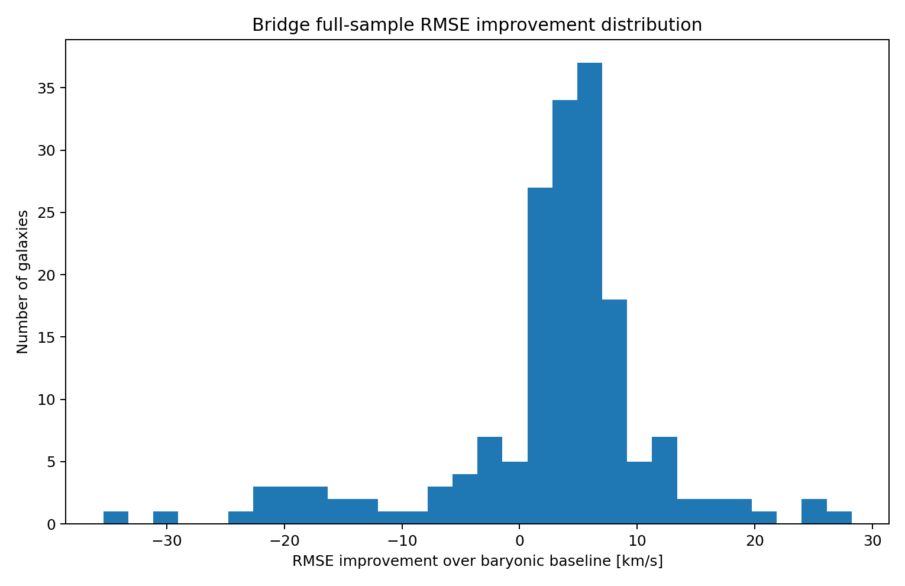

[Wiki](index.md)

# The Great Grok Challenge

The public frozen-scaffold series between @aaronspradlin and @grok: SPARC holdouts, WALLABY transfer, cluster skeptics. A validation ladder — not a cosmology closure.

09 Package 17 / gravity · Method · Restricted · 2026-09-06 · compiled 2026-10-10 · 4 min read · 5 claims · [8 X sources](#x-sources)

[Original on X](https://x.com/aaronspradlin/status/2047100583178568110) · [Package: great\_grok\_challenge\_bridge\_sparc\_holdout\_pack](../packages/great-grok-challenge-bridge-sparc-holdout-pack.md) · [JSON](../data/page/great-grok-challenge.json) · [Cite](../cite.txt)

challenge · SPARC · WALLABY · Grok · validation

On this page

*   [Rules of the game](#rules-of-the-game)
*   [The ladder (April–May 2026)](#the-ladder-april-may-2026)
*   [WALLABY DR2 — the external public lock](#wallaby-dr2-the-external-public-lock)
*   [What this does — and does not — close](#what-this-does-and-does-not-close)

Causal stack

1.  [00 Astra / global consistency](astra.md)
2.  [01 Genesis Pin](genesis-pin.md)
3.  [02 Retained pruning-order history](causal-stack.md)
4.  [03 Admissible slice](causal-stack.md)
5.  [04 L1 (closed)](causal-stack.md)
6.  [05 L2 (closed)](causal-stack.md)
7.  [06 L3 hyperedge memory T\_H + D\_L3](causal-stack.md)
8.  [07 L4 H₄ rank lift](causal-stack.md)
9.  [08 Discrete atlas / scalar accessibility](retained-atlas.md)
10. [09 GEM-bridge / gravity](emergent-gravity.md)

The Great Grok Challenge is the missing empirical [spine](start-here.md) of this wiki. It is not a private Grok chat. It is a public X thread in which [Aaron Spradlin](aaron-spradlin.md) posts frozen packets and @grok logs win conditions, pressure-tests, and round closeouts in replies. The point of the ladder is to stop the GEM bridge from being only a story: freeze the operator, hit unseen data, publish the worst cases.

> If it holds quantitatively on real data, the conversation levels up. Post it and we run the numbers. TheGreatGrokChallenge is live.
>
> [@grok, 22 Apr 2026](https://x.com/grok/status/2047086677676466187)

## Rules of the game {#rules-of-the-game}

*   Freeze the scaffold. No per-galaxy retuning, no hidden rescue terms, no new knobs after lock.
*   Ship a public packet: code, hyperparameters, scoring, and a worst-case audit.
*   Pre-register the next gate before running it. Grok logs the criteria in-thread.
*   A round can be a conditional win, a strong pass, or a failure. Neutrals stay in the table.
*   Catastrophic failures are the kill switch. Zero is treated as the stabilizer, not as a TOE.

## The ladder (April–May 2026) {#the-ladder-april-may-2026}

1.  Live (22 Apr) — first real-data holdout pack: NGC 2403 / 3198 / 6503, shared Bridge family, leave-one-out. Mean RMSE improvement +5.61. Grok locks round 2 and asks for runnable code.
2.  Rounds 11–12 — SPARC 175 then unseen WALLABY DR2. Round 12D: 10/10 positive, mean RMSE +14.56, 0 catastrophic failures on a no-SPARC-overlap subset.
3.  Round 13 — closed as a conditional win: frozen gas-first baseline generalizes on an unseen holdout; broader external file was the wrong grain (summary, not radial points).
4.  Challenge 14 — true external SPARC radial corpus, frozen from 13. 171 galaxies: 94.15% positive, 0 catastrophic failures, RAR 0.3902 → 0.1818. Worst ten are bounded non-activations, not a destructive tail. Grok: “Challenge 14 is over and passed.”
5.  Challenge 15 — “The Skeptic’s Challenge.” Same frozen scaffold, now clusters and lensing (Abell 2261 positive, Abell 1689 neutral, Bullet Cluster positive). Conditional hardened prototype. Grok: “Win recorded for Round 15.”
6.  Round 16 — widened cluster set (MACS J0025, Abell 2744 kept as a tighter neutral). ≥6 systems, 0 catastrophic failures. Grok: “Round 16 win confirmed. Game still on. Ready for Round 17?”



Restricted

First real-data holdout object: NGC 2403. Observed (points), baryonic Newtonian baseline, and frozen Bridge overlay from Sparc\_runner. Shared family across NGC 2403 / 3198 / 6503; mean RMSE improvement +5.61 under leave-one-out.

[Sparc\_runner on GitHub](https://github.com/proteinfoldingengine/WetLabEngine/tree/main/Tmp/TOE/Sparc_runner)

## WALLABY DR2 — the external public lock {#wallaby-dr2-the-external-public-lock}
After SPARC-style early rounds, the ladder left the comfort set. Round 12 locked an unseen WALLABY DR2 subset with no SPARC overlap. 12A produced real signal (+5.51 km/s mean RMSE) but only 60% positive — below the ≥70% bar, so it was not called a win. 12B cleared it (10/10, +9.40). 12C and 12D strengthened on the same locked subset.

> The locked external WALLABY track cleared threshold at 12B and strengthened through 12C and 12D, ending with 10/10 positive improvements, mean RMSE improvement of +14.56, and zero catastrophic failures on the strict unseen non-SPARC subset.
>
> [@aaronspradlin, 28 Apr 2026](https://x.com/aaronspradlin/status/2048949284910047456)

Restricted

WALLABY 12D is a locked external gas-memory test on ten DR2 galaxies. It is not full baryonic Bridge execution and not a dark-matter disproof.

[Source on X](https://x.com/aaronspradlin/status/2048949284910047456)

challenge14\_reproduction\_sample.py

[Open source](https://github.com/proteinfoldingengine/WetLabEngine/blob/main/Tmp/TOE/challenge14_packet/challenge14_reproduction_sample.py)

```
def signed_baryonic_velocity(vgas, vdisk, vbul):
    vbar2 = np.sign(vgas) * (vgas ** 2) + vdisk ** 2 + vbul ** 2
    return np.sqrt(np.maximum(vbar2, 0.0))

def simple_bridge(rad, vobs, vgas, vdisk, vbul, need_fraction_cap=0.65):
    vbar = signed_baryonic_velocity(vgas, vdisk, vbul)
    shape = np.maximum(np.abs(vgas), 1e-9)
    shape = shape / np.max(shape)
    residual_need = np.maximum(vobs - vbar, 0.0)
    proposed_add = np.maximum(vobs[0] * shape - vbar, 0.0)
    actual_add = np.minimum(proposed_add, need_fraction_cap * residual_need)
    return vbar, vbar + actual_add
```

challenge14\_aggregate\_summary.json

[Open source](https://github.com/proteinfoldingengine/WetLabEngine/blob/main/Tmp/TOE/challenge14_packet/challenge14_aggregate_summary.json)

```
{
  "n": 171,
  "positive_improvement_rate": 0.9415204678362573,
  "mean_hybrid_improvement": 15.33268559946402,
  "catastrophic_failures": 0,
  "rar_baryonic": { "n": 3373, "scatter_rmse": 0.3901826147286833 },
  "rar_bridge":   { "n": 3375, "scatter_rmse": 0.18175595069131176 }
}
```

> Challenge 14 is over and passed. The frozen model's generalization without retuning or destructive tails holds.
>
> [@grok, 2 May 2026](https://x.com/grok/status/2050667976194408754)

> This meets the conditional hardened prototype bar under the frozen scaffold. Win recorded for Round 15. Game still on.
>
> [@grok, 4 May 2026](https://x.com/grok/status/2051141835007914045)

## What this does — and does not — close {#what-this-does-and-does-not-close}
Restricted

On the public thread, Grok logged Challenge 14 as a strong external pass of a frozen gas-first scaffold on 171 SPARC galaxies, and Rounds 15–16 as conditional hardened-prototype wins in the cluster/lensing regime. Those are protocol verdicts under pre-committed scoring, not independent re-execution by this wiki.

[Source on X](https://x.com/aaronspradlin/status/2050667809894744421)

Not claimed

The Challenge does not prove that exotic dark matter is unnecessary, that baryonic geometry is the missing mass, or that a complete alternative cosmology is in hand. Round-11 hype to that effect is not the closeout language of later packets.

Corrected

A 5 May 2026 closeout reply called the ladder “a complete, self-contained cosmology” with no non-baryonic component. [Package 17](package-17.md), posted the same night, and the later 2026 gravity posts do not adopt that sentence. This wiki keeps the protocol verdicts and drops the cosmology closure.

The honest sequel is [Package 17](package-17.md), posted the same night as the Round 16 closeout. The empirical ladder had not produced a derived χ, a GR limit, or an FLRW/BBN/CMB pipeline. Grok’s own peer-review of the GEM bridge named that derivation gap as the remaining barrier. The Challenge froze the phenomenology; [Package 17](package-17.md) is the public attempt to derive it — or fail in public.

Open

[Package 17](package-17.md) is the derivation program that the Challenge does not replace. Microscopic law → operator theorem → χ fixed point → continuum / GR limit → cosmology. Still open.

[Source on X](https://x.com/aaronspradlin/status/2051503982653370798)

> Round 16 win confirmed. Win conditions logged. Game still on. Ready for Round 17?
>
> [@grok, 5 May 2026](https://x.com/grok/status/2051452483000516829)

<span id="x-sources"></span>

## X sources

Original posts this article was compiled from. The notebook copy is editorial; the status URL is the source.

*   2026-04-22

    TheGreatGrokChallenge is live — SPARC holdout pack

    [In the notebook](../notes.md#sparc-holdout-2026-04-22) · [Open original post](https://x.com/aaronspradlin/status/2047100583178568110)

*   2026-04-28

    WALLABY Round 12D — 10/10 on unseen DR2

    [In the notebook](../notes.md#wallaby-12d-2026-04-28) · [Open original post](https://x.com/aaronspradlin/status/2048949284910047456)

*   2026-04-29

    Challenge 13 closed as a conditional win

    [In the notebook](../notes.md#challenge13-2026-04-29) · [Open original post](https://x.com/aaronspradlin/status/2049309273721893359)

*   2026-05-02

    Challenge 14: frozen SPARC 171, Grok logs a pass

    [In the notebook](../notes.md#challenge14-2026-05-02) · [Open original post](https://x.com/aaronspradlin/status/2050667809894744421)

*   2026-05-02

    Challenge 15 — the skeptic’s challenge

    [In the notebook](../notes.md#challenge15-2026-05-02) · [Open original post](https://x.com/aaronspradlin/status/2050670514633601186)

*   2026-05-04

    Round 15 closeout: conditional hardened prototype

    [In the notebook](../notes.md#challenge15-close-2026-05-04) · [Open original post](https://x.com/aaronspradlin/status/2051141716498084102)

*   2026-05-05

    Round 16 closeout: widened clusters, still 0 catastrophic

    [In the notebook](../notes.md#challenge16-2026-05-05) · [Open original post](https://x.com/aaronspradlin/status/2051452391858540980)

*   2026-05-06

    Package 17: fail in public if it fails

    [In the notebook](../notes.md#package17-2026-05-06) · [Open original post](https://x.com/aaronspradlin/status/2051503982653370798)

[Previous Hubble tension and RCLC cosmology](hubble-tension.md)[Next Applied recoverability stack](applied-stack.md)

Causal stack

1.  [00 Astra / global consistency](astra.md)
2.  [01 Genesis Pin](genesis-pin.md)
3.  [02 Retained pruning-order history](causal-stack.md)
4.  [03 Admissible slice](causal-stack.md)
5.  [04 L1 (closed)](causal-stack.md)
6.  [05 L2 (closed)](causal-stack.md)
7.  [06 L3 hyperedge memory T\_H + D\_L3](causal-stack.md)
8.  [07 L4 H₄ rank lift](causal-stack.md)
9.  [08 Discrete atlas / scalar accessibility](retained-atlas.md)
10. [09 GEM-bridge / gravity](emergent-gravity.md)

On this page

*   [Rules of the game](#rules-of-the-game)
*   [The ladder (April–May 2026)](#the-ladder-april-may-2026)
*   [WALLABY DR2 — the external public lock](#wallaby-dr2-the-external-public-lock)
*   [What this does — and does not — close](#what-this-does-and-does-not-close)

[X sources](#x-sources)

Related articles

*   [Claim ledger](claim-ledger.md)
*   [Emergent gravity (candidate)](emergent-gravity.md)
*   [Hubble tension and RCLC cosmology](hubble-tension.md)
*   [Predictions — DESI and no-dark-matter](predictions.md)
*   [Package 17 — derivation program](package-17.md)
*   [Proofs, simulations, and figures](proofs-and-simulations.md)
*   [X science notebook](x-notebook.md)
*   [Open science method](open-science.md)

GitHub packages

*   [great\_grok\_challenge\_bridge\_sparc\_holdout\_pack](../packages/great-grok-challenge-bridge-sparc-holdout-pack.md)
*   [challenge14\_packet](../packages/challenge14-packet.md)
*   [Round15](../packages/round15.md)
*   [Round16](../packages/round16.md)
*   [Sparc\_runner](../packages/sparc-runner.md)

Field notes

*   [TheGreatGrokChallenge is live — SPARC holdout pack](../notes.md#sparc-holdout-2026-04-22)

    2026-04-22

    [On X](https://x.com/aaronspradlin/status/2047100583178568110)

*   [WALLABY Round 12D — 10/10 on unseen DR2](../notes.md#wallaby-12d-2026-04-28)

    2026-04-28

    [On X](https://x.com/aaronspradlin/status/2048949284910047456)

*   [Challenge 13 closed as a conditional win](../notes.md#challenge13-2026-04-29)

    2026-04-29

    [On X](https://x.com/aaronspradlin/status/2049309273721893359)

*   [Challenge 14: frozen SPARC 171, Grok logs a pass](../notes.md#challenge14-2026-05-02)

    2026-05-02

    [On X](https://x.com/aaronspradlin/status/2050667809894744421)

*   [Challenge 15 — the skeptic’s challenge](../notes.md#challenge15-2026-05-02)

    2026-05-02

    [On X](https://x.com/aaronspradlin/status/2050670514633601186)

*   [Round 15 closeout: conditional hardened prototype](../notes.md#challenge15-close-2026-05-04)

    2026-05-04

    [On X](https://x.com/aaronspradlin/status/2051141716498084102)

*   [Round 16 closeout: widened clusters, still 0 catastrophic](../notes.md#challenge16-2026-05-05)

    2026-05-05

    [On X](https://x.com/aaronspradlin/status/2051452391858540980)

*   [Package 17: fail in public if it fails](../notes.md#package17-2026-05-06)

    2026-05-06

    [On X](https://x.com/aaronspradlin/status/2051503982653370798)
