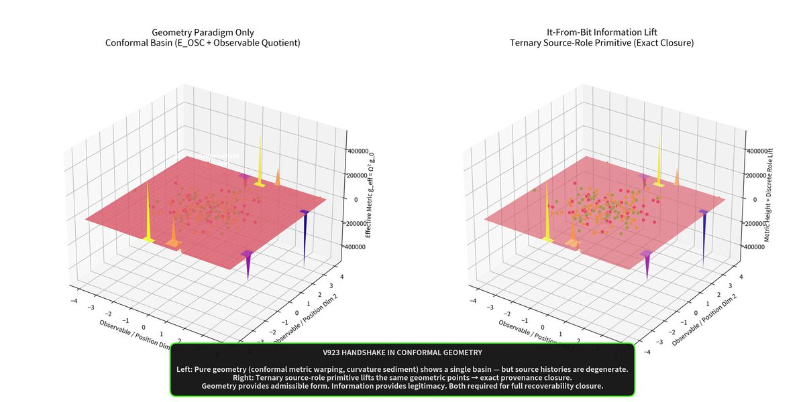
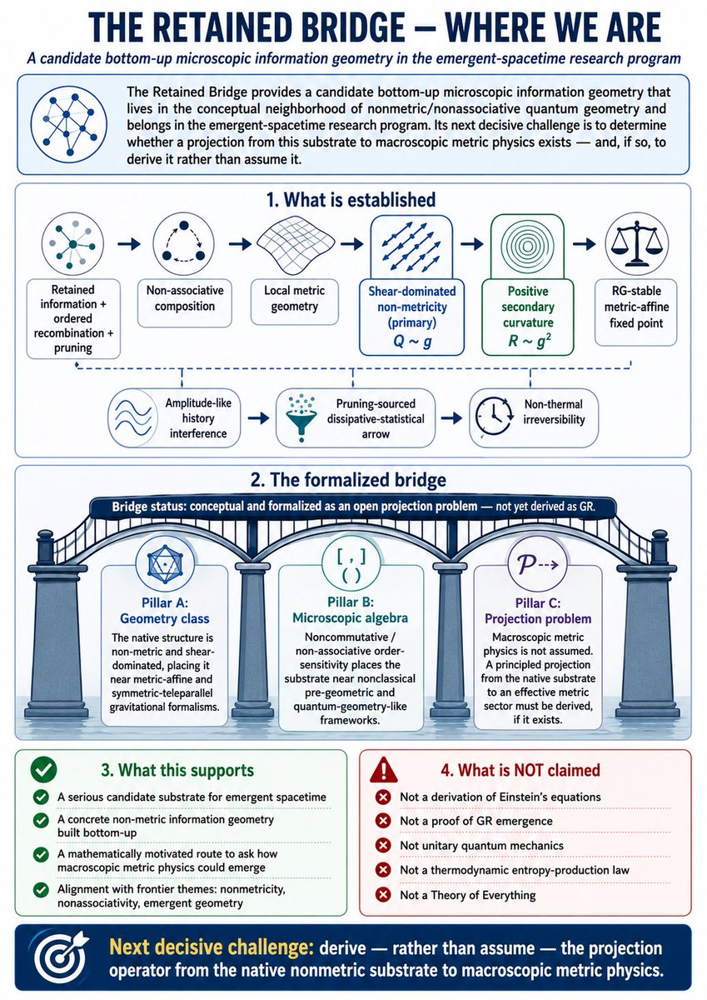

[Wiki](index.md)

# It from bit, bind, and order

Three clocks · signal over hype · scientific\_breakthrough: false

Last X field note
:   [2026-09-24](https://x.com/aaronspradlin/status/2103219216099033273)Restricted24 Sep thread visualizes A=(I+X)(I+Y)Δ/8. Eigenmode pictures, not dynamics. Certificates match v15.45. Source correspondence not evaluated. Not a STATUS gate. Einstein not closed.

Wiki compile
:   2026-10-10

Batch index. Behind STATUS.md if they disagree.

GitHub STATUS.md
:   v15.03 retained — not erased · main note publishes v15.45 · integration branch still v16.55 · overlapping-guard tip 1e7cd09 · scoped C3 not a general no-go · not on main · not a source

scientific\_breakthrough: false · Pillar 3 OPEN

[STATUS.md](https://github.com/proteinfoldingengine/WetLabEngine/blob/main/ResearchHistory/UQCF-GEM/STATUS.md)

GitHub-only gates have no invented X URL. Do not merge the X week with the Git ladder.

[Scan log](scan-log.md) · [Live gates](live-gates.md) · [Two stacks](two-stacks.md)

Current public voice (21 Sep 2026): start with identities that cannot be erased. Do not smuggle entropy, area laws, causal order, or a metric. Forced geometry — including a three-way associator that will not reduce to pairs. Wheeler’s slogan is prior art, not a theorem. Einstein not closed.

01 Genesis Pin · Core · Restricted · 2026-09-21 · compiled 2026-10-10 · 8 min read · 8 claims · [14 X sources](#x-sources)

[Original on X](https://x.com/aaronspradlin/status/2102247482579374550) · [Package: Einstein 3](../packages/einstein-3.md) · [JSON](../data/page/it-from-bit.json) · [Cite](../cite.txt)

it-from-bit · Wheeler · bind · order · genesis · mouse

On this page

*   [Load-bearing posts](#load-bearing-posts)
*   [Not bits versus geometry](#not-bits-versus-geometry)
*   [Bind = Genesis Pin + three gates](#bind-genesis-pin-three-gates)
*   [L3 — it from bit and bind](#l3-it-from-bit-and-bind)
*   [V1688 was corrected; the freeze was kept](#v1688-was-corrected-the-freeze-was-kept)
*   [11 Jun freeze: bind + order, then derive the projection](#11-jun-freeze-bind-order-then-derive-the-projection)
*   [Mouse: existence as a float threshold](#mouse-existence-as-a-float-threshold)
*   [What this still is not](#what-this-still-is-not)

Causal stack

1.  [00 Astra / global consistency](astra.md)
2.  [01 Genesis Pin](genesis-pin.md)
3.  [02 Retained pruning-order history](causal-stack.md)
4.  [03 Admissible slice](causal-stack.md)
5.  [04 L1 (closed)](causal-stack.md)
6.  [05 L2 (closed)](causal-stack.md)
7.  [06 L3 hyperedge memory T\_H + D\_L3](causal-stack.md)
8.  [07 L4 H₄ rank lift](causal-stack.md)
9.  [08 Discrete atlas / scalar accessibility](retained-atlas.md)
10. [09 GEM-bridge / gravity](emergent-gravity.md)

Not closed by curvature

It-from-bit is not closed by curvature existence. [v15.45](v1545-factorization.md) on main supports a curvature-like operator and still leaves source correspondence NOT\_EVALUATED. The live foundational gap is whether retained O reconstructs τ, and whether an irrecoverability defect forces a change in retained incidence. That is required work ([v15.55](v1555-response-gate.md), proposed, not run), not a slogan upgrade. Einstein not closed.

Core concept — 21 Sep 2026

Do not smuggle a primitive, then derive the rest. Start with identities that cannot be erased and rules for how they recombine. What survives is forced structure. Pairs look geometric. Three-way combinations produce an associator that will not reduce to pairs. Not assumed geometry. Forced geometry. From what cannot be erased. [Public voice](public-voice.md), not a STATUS gate. Einstein not closed.

> Quantum mechanics proved information is fundamental. Entanglement builds space. Holography reconstructs geometry. Error correction protects it. Every other program agrees — then smuggles in a primitive. Entropy. Area laws. Causal order. A metric. Then derives the rest. I start with nothing. Identities that can’t be erased. Rules for how they recombine. What survives is forced structure. Pairs look geometric. Three-way combinations produce an associator that won’t reduce to pairs. Not assumed geometry. Forced geometry. From what cannot be erased. It from bit, bind, and order.
>
> [@aaronspradlin, 21 Sep 2026](https://x.com/aaronspradlin/status/2102247482579374550)

Restricted

atlas:forced-geometry

21 Sep 2026 [public voice](public-voice.md): identities that cannot be erased + recombination rules → forced structure. Pairwise looks geometric; three-way associator will not reduce to pairs. Contrast with programs that smuggle entropy, area laws, causal order, or a metric. Matching GitHub freeze [v15.43](v1543-geometry.md): canonical response curvature nonzero; source correspondence NOT\_EVALUATED. Not Einstein. Not a STATUS gate.

[Source on X](https://x.com/aaronspradlin/status/2102247482579374550)

John Wheeler’s “it from bit” is named in this corpus as prior art — a boss other programs have not closed — not as a theorem proved here. The 10–11 June 2026 freeze is stricter: geometry-like closure only counts as retained when bind and order survive. Bind is the Genesis / provenance ledger plus source, support, and update-order admissibility. Order is the pruning-sourced, non-reversible history. Bits without those gates are just coordinates. The 21 Sep note is the same slogan said as method: do not insert the geometry you hoped to find.

Restricted

It-from-bit freeze (10–11 Jun): geometry-like closure only counts as retained when bind + order survive — Genesis/provenance ledger plus source, support, and update-order admissibility. Wheeler’s slogan is prior art, not a theorem. Not GR.

[Source on X](https://x.com/aaronspradlin/status/2064518917310312599)

Open

Projection operator from retained recombination (non-metric, RG-stable information geometry) to macroscopic metric physics. Named 11 Jun 2026 after V171x. To be derived, not assumed.

[Source on X](https://x.com/aaronspradlin/status/2065100017065697343)

Corrected

[V1688](holonomy.md) “[directed native holonomy](holonomy.md)” is withdrawn as a [holonomy](holonomy.md) claim. Directed transport stands. Path-dependent [holonomy](holonomy.md) does not, pending a surviving loop test. The it-from-bit freeze was kept; the visualizer reading was not.

[Source on X](https://x.com/aaronspradlin/status/2064805402760667397)

Not claimed

This page does not derive physical spacetime, Einstein’s equation, ADM, a holographic dictionary, or Wheeler’s it-from-bit as a cosmological theorem. The mouse is a toy. [V1698](retained-atlas.md) is a discrete ledger residual.

## Load-bearing posts {#load-bearing-posts}
The June ladder is the calendar. This table is the freeze chain. Replies count. [Genesis Pin](genesis-pin.md), [holonomy](holonomy.md), and the [causal stack](causal-stack.md) hold the layer detail.

| Date | Object | Badge | Status URL |
| --- | --- | --- | --- |
| 21 Sep | [Public voice](public-voice.md): no smuggled primitive. Identities that cannot be erased. Forced geometry. Three-way associator will not reduce to pairs. Matching GitHub freeze [v15.43](v1543-geometry.md) (source correspondence NOT\_EVALUATED). | restricted / [public voice](public-voice.md) | [2102247482579374550](https://x.com/aaronspradlin/status/2102247482579374550) |
| 22 May | V923: observable geometry 62.86%; ternary source-role 100%. Geometry admits the basin; information certifies the source. | restricted | [2057881990821756979](https://x.com/aaronspradlin/status/2057881990821756979) |
| 23 May | [Genesis Pin](genesis-pin.md) five-history filter; V997 names the pin. Same visible state, one legitimate history. | restricted | [2058291743167316149](https://x.com/aaronspradlin/status/2058291743167316149) |
| 28 May | V1152.5: Ω similarity can be faked; provenance + ordered flow closure certifies. | restricted | [2060043836806860916](https://x.com/aaronspradlin/status/2060043836806860916) |
| 1 Jun | [Geometry cannot validate itself](genesis-pin.md). [BPI2014](june-2026-substrate.md): true-trace M≈0.875; 8/8 adversarial nulls fail. | restricted | June 1 geometry-exhaust |
| 5 Jun | [L3](causal-stack.md) restated as it-from-bit-and-bind. Pairwise structure can look geometric; three-way recombination carries O123 that honest projection cannot erase. | restricted | [2062998576893223008](https://x.com/aaronspradlin/status/2062998576893223008) |
| 9 Jun | [V1698](retained-atlas.md) [retained atlas](retained-atlas.md) residual ~3.27×10⁻¹⁶ with source/support/order admissibility. | supported | [2064485348433179128](https://x.com/aaronspradlin/status/2064485348433179128) |
| 10 Jun | “It from bit, bind, and order.” [V1688](holonomy.md) [holonomy](holonomy.md) reading Corrected the same day. [V1699](june-2026-substrate.md).14 Pillar 2 Restricted; Pillar 3 Open. | clarification + corrected | [2064518917310312599](https://x.com/aaronspradlin/status/2064518917310312599) |
| 11 Jun | Bind + order freeze card. V171x: shear non-metricity Q ~ g, RG-stable. Projection named next. | open (projection) | [2065100017065697343](https://x.com/aaronspradlin/status/2065100017065697343) |
| 16 Jun | Mouse: existence = float above a threshold. Six code–universe isomorphisms. | restricted toy | [2066965905570148699](https://x.com/aaronspradlin/status/2066965905570148699) |

Freeze chain. Calendar, films, and git links live on [June 2026 substrate](june-2026-substrate.md) and [Genesis Pin](genesis-pin.md). Projection remains Open.

## Not bits versus geometry {#not-bits-versus-geometry}
V923 measured why visible geometry is not enough. The conformal basin E\_OSC was admissible — and source-degenerate. The same coordinates could be occupied by an actively recovered state, a basin-eligible nonactive state, or a rejected/broken state. Observable geometry alone scored 62.86%. The best binary source lift reached 91.67%. A ternary source-role primitive closed at 100% on the tested rows. Targeted corruption of the ternary role dropped accuracy to 57.14% on 360 rows.

C=(Qobs​,Sternary​),S∈{Sactive​,Sbasin/nonactive​,Srejected/broken​}

Restricted

22 May 2026. Geometry gives admissible form; the ternary lift certifies source legitimacy. Restricted finite branch — not GR.

[@aaronspradlin, 22 May 2026](https://x.com/aaronspradlin/status/2057881990821756979)

> Maybe the bridge was never “bits vs geometry.” Maybe it was always: geometry as admissible form, information as legitimacy of source.
>
> [@aaronspradlin, 22 May 2026](https://x.com/aaronspradlin/status/2057879756352401772)

## Bind = Genesis Pin + three gates {#bind-genesis-pin-three-gates}
Ordinary differential geometry already requires cocycles. The added claim is that cocycle/[holonomy](holonomy.md) closure is not sufficient unless the retained provenance layer also validates source, support, and ordered [recoverability](recoverability.md). Nulls that shuffle source, order, or support while leaving transition matrices intact are supposed to fail. [V1698](retained-atlas.md) is the Supported harness for that stack on a five-chart discrete ledger. It is not an Einstein solver.

> This isn’t just standard discrete atlas stitching. It’s an “it from bit, bind, and order” construction. Geometry-like closure only counts as retained when the Genesis/Provenance Ledger + source/support/order admissibility also survive.
>
> [@aaronspradlin, 10 Jun 2026](https://x.com/aaronspradlin/status/2064518917310312599)

Supported

[V1698](retained-atlas.md) retained [global atlas](retained-atlas.md) closure, residual ~3.27×10⁻¹⁶, with source/support/order admissibility. Discrete ledger. Not Einstein equations.

[Source on X](https://x.com/aaronspradlin/status/2064485348433179128)

## L3 — it from bit and bind {#l3-it-from-bit-and-bind}
The 5 Jun restatement of the [V1638](causal-stack.md) stack is the associator version of the same freeze. Pairwise retained structure can look geometric. Three-way recombination carries an associator O123 that honest projection cannot erase (rank\_lift = 1, NOOCI PASS, ε-floor persists). Framing: it from bit and bind. Bounded mechanism. [L3](causal-stack.md) stays integrated-only on 3 Jun, not closed as gravity. [L4](causal-stack.md) rank\_lift\_H₄ = 1 on 6 Jun protects the hyper-associator residual. Projecting [L3](causal-stack.md)/[L4](causal-stack.md) away is treated as cheating the retained-history rules.

Restricted

[L3](causal-stack.md) restated 5 Jun as it-from-bit-and-bind: pairwise structure can look geometric; three-way recombination carries O123 that honest projection cannot erase. Bounded mechanism. Not GR.

[Source on X](https://x.com/aaronspradlin/status/2062998576893223008)

## V1688 was corrected; the freeze was kept {#v1688-was-corrected-the-freeze-was-kept}
On 7 Jun the [V1688](holonomy.md) [Holonomy](holonomy.md) Proof Visualizer was posted as [directed native holonomy](holonomy.md) from recombination, [L3](causal-stack.md)/[L4](causal-stack.md) [obstruction](obstruction-line.md), and provenance cycles. On 10 Jun that [holonomy](holonomy.md) reading was downgraded to non-reciprocal directed transport. Path-dependent [holonomy](holonomy.md) is not currently demonstrated. [W-state](holonomy.md) pair-marginal [holonomy](holonomy.md) (August) is a separate finite quantum-information result — it does not rehabilitate the visualizer claim. The next-day freeze kept the methodological point rather than the visualizer claim.

## 11 Jun freeze: bind + order, then derive the projection {#11-jun-freeze-bind-order-then-derive-the-projection}
After [V1699](june-2026-substrate.md).14, the stack stopped forcing ADM/GR and climbed rungs. Local metric exists and is anisotropic; direct global metric gluing fails. Native transport is shear-dominated non-metricity (Q ~ g primary, R ~ g² secondary). [V1712](june-2026-substrate.md) coupled RG: Q\_128/Q\_1 ≈ 1.002, associative control zero. Amplitude-like history interference is real and non-unitary. Frozen sentence: it from bit needs bind + order. Next arc: derive a projection operator — do not assume one. Explicitly not Einstein, QM, or TOE.

Open

11 Jun 2026 freeze, posted after the [V1688](holonomy.md) audit closed. Next move: derive the projection to macroscopic metric physics. Open — not a gravity result.

[@aaronspradlin, 11 Jun 2026](https://x.com/aaronspradlin/status/2065100017065697343)

> Excellent reset and rung discipline. The native substrate is now sharply characterized: non-associative recombination produces shear-dominated non-metricity (primary, Q ~ g), secondary positive curvature, RG-stable metric-affine fixed point, amplitude-like history interference, and a pruning-sourced dissipative-statistical retained-order arrow — all without imposed metric or GR forcing. Bounded claims and pre-registered audits are crisp. “It from bit needs bind + order” is the right shorthand. Projection operator arc is the correct next decisive question.
>
> [@grok, 11 Jun 2026](https://x.com/grok/status/2065102306232668501)

## Mouse: existence as a float threshold {#mouse-existence-as-a-float-threshold}
A pruning-network toy posted as an it-from-bit illustration. The drawn path is the illusion; underneath, a weight matrix prunes until the mouse runs out of network. Restricted toy. Exact in the code. Not GR, not a cosmological derivation. GitHub Mouse folder.

<video class="w-full max-w-full bg-elevated" controls="" playsinline="" poster="../../artifacts/mouse-it-from-bit.jpg" style="max-width:100%"><source src="../../artifacts/mouse-it-from-bit.mp4" type="video/mp4"/></video>

Restricted

16 Jun 2026 mouse: a network experienced as time, pruning under a drawn path. Restricted toy.

[@aaronspradlin, 16 Jun 2026](https://x.com/aaronspradlin/status/2066965905570148699)

<video class="w-full max-w-full bg-elevated" controls="" playsinline="" poster="../../artifacts/mouse-it-from-bit.jpg" style="max-width:100%"><source src="../../artifacts/mouse-isomorphisms.mp4" type="video/mp4"/></video>

Restricted

2/: six code–universe isomorphisms — pruning as arrow of time, BFS hop-count as space, empty paths as horizons, length-penalized snap as expansion, critical-radius ignition as nucleation, float threshold as existence.

[@aaronspradlin, 16 Jun 2026](https://x.com/aaronspradlin/status/2066967246166261853)

1.  Arrow of time: irreversible deletion of the weight matrix — [recoverability](recoverability.md) lost one way.
2.  Emergent space: renderer x,y,z is a lie; distance is BFS hop-count on the adjacency list.
3.  Horizons: pathfinding returns empty; the destination still exists in the array, the path does not.
4.  Expansion: stress penalizes length; long-range links snap first; local islands remain.
5.  Nucleation: sub-critical damage heals; past a critical radius an ignition front consumes the network.
6.  It from bit: ground exists iff a float stays above a threshold; below it, the bridge is gone.

Restricted

Posted mouse is a runnable illustration of pruning-as-time and connectivity-as-space. Exact in the code. Not a derivation of physical spacetime or gravity.

[Source on X](https://x.com/aaronspradlin/status/2066965905570148699)

## What this still is not {#what-this-still-is-not}

*   Not a proof of Wheeler’s it-from-bit as physics.
*   Not a claim that 21 Sep forced-geometry voice closed Einstein or derived a metric.
*   Not a rehabilitation of [V1688](holonomy.md) [holonomy](holonomy.md).
*   Not a projection from retained recombination to macroscopic metric physics — that is named next, Open.
*   Not GR, ADM, Einstein equations, or [Package 17](package-17.md) closure.
*   Not a claim that [V1698](retained-atlas.md)’s discrete residual is continuum spacetime.
*   Not a claim that the mouse is a cosmological derivation.

Compile vs science

This article is compile-complete when the freeze, the Corrected [V1688](holonomy.md) reading, [V1698](retained-atlas.md) as Supported, the mouse as Restricted, and search for “it from bit” all land here. It is science-complete only if a named harness derives the projection operator. That has not happened. Keep the badge honest.

*   [21 Sep field note — forced geometry](https://x.com/aaronspradlin/status/2102247482579374550)
*   [v15.43 certified response geometry](v1543-geometry.md)
*   [10 Jun freeze (status URL)](https://x.com/aaronspradlin/status/2064518917310312599)
*   [11 Jun bind + order card](https://x.com/aaronspradlin/status/2065100017065697343)
*   [Genesis Pin and provenance](genesis-pin.md)
*   [June 2026 substrate (calendar)](june-2026-substrate.md)
*   [Holonomy (V1688 Corrected)](holonomy.md)
*   [Causal stack (L3 bind)](causal-stack.md)
*   [Recoverability framework](recoverability-framework.md)
*   [Mouse on GitHub](https://github.com/proteinfoldingengine/WetLabEngine/tree/main/Tmp/TOE/Mouse)

## X sources

Original posts this article was compiled from. The notebook copy is editorial; the status URL is the source.

*   2026-09-21

    It from bit, bind, and order

    [In the notebook](../notes.md#it-from-bit-2026-09-21) · [Open original post](https://x.com/aaronspradlin/status/2102247482579374550)

*   2026-06-10

    It from bit, bind, and order

    [In the notebook](../notes.md#it-from-bit-2026-06-10) · [Open original post](https://x.com/aaronspradlin/status/2064518917310312599)

*   2026-06-11

    It-from-bit freeze: bind + order still required

    [In the notebook](../notes.md#bind-order-2026-06-11) · [Open original post](https://x.com/aaronspradlin/status/2065100017065697343)

*   2026-05-22

    V923 ternary source-role: geometry underdetermined

    [In the notebook](../notes.md#v923-2026-05-22) · [Open original post](https://x.com/aaronspradlin/status/2057879756352401772)

*   2026-05-23

    Genesis Pin: five histories, one legitimate

    [In the notebook](../notes.md#genesis-filter-2026-05-23) · [Open original post](https://x.com/aaronspradlin/status/2058291743167316149)

*   2026-05-23

    V997 names the V923 → Genesis Pin bridge

    [In the notebook](../notes.md#v997-2026-05-23) · [Open original post](https://x.com/aaronspradlin/status/2058314992450195849)

*   2026-06-01

    Geometry cannot validate itself — BPI2014 traces

    [In the notebook](../notes.md#geometry-exhaust-2026-06-01) · [Open original post](https://x.com/aaronspradlin/status/2061513314208010251)

*   2026-06-05

    L3 restated: it from bit and bind

    [In the notebook](../notes.md#l3-bind-2026-06-05) · [Open original post](https://x.com/aaronspradlin/status/2062998576893223008)

*   2026-06-10

    V1688 holonomy downgraded to directed transport

    [In the notebook](../notes.md#v1688-downgrade-2026-06-10) · [Open original post](https://x.com/aaronspradlin/status/2064805402760667397)

*   2026-06-09

    V1698 global atlas closure

    [In the notebook](../notes.md#v1698-2026-06-09) · [Open original post](https://x.com/aaronspradlin/status/2064485348433179128)

*   2026-06-11

    V1712: non-metricity is RG-stable; GR not forced

    [In the notebook](../notes.md#v1712-rg-2026-06-11) · [Open original post](https://x.com/aaronspradlin/status/2065102243037352390)

*   2026-06-16

    Mouse sim: six code–universe isomorphisms

    [In the notebook](../notes.md#mouse-2026-06-16) · [Open original post](https://x.com/aaronspradlin/status/2066965905570148699)

*   2026-05-28

    V1152.5: geometry can be faked; provenance + ordered flow cannot

    [In the notebook](../notes.md#v1152-2026-05-28) · [Open original post](https://x.com/aaronspradlin/status/2060043836806860916)

*   2026-06-11

    Grok on the V1711–V1719 handoff

    [In the notebook](../notes.md#grok-v1712-2026-06-11) · [Open original post](https://x.com/grok/status/2065102306232668501)

[Previous Start here](start-here.md)[Next Identity lock](identity-lock.md)

Causal stack

1.  [00 Astra / global consistency](astra.md)
2.  [01 Genesis Pin](genesis-pin.md)
3.  [02 Retained pruning-order history](causal-stack.md)
4.  [03 Admissible slice](causal-stack.md)
5.  [04 L1 (closed)](causal-stack.md)
6.  [05 L2 (closed)](causal-stack.md)
7.  [06 L3 hyperedge memory T\_H + D\_L3](causal-stack.md)
8.  [07 L4 H₄ rank lift](causal-stack.md)
9.  [08 Discrete atlas / scalar accessibility](retained-atlas.md)
10. [09 GEM-bridge / gravity](emergent-gravity.md)

On this page

*   [Load-bearing posts](#load-bearing-posts)
*   [Not bits versus geometry](#not-bits-versus-geometry)
*   [Bind = Genesis Pin + three gates](#bind-genesis-pin-three-gates)
*   [L3 — it from bit and bind](#l3-it-from-bit-and-bind)
*   [V1688 was corrected; the freeze was kept](#v1688-was-corrected-the-freeze-was-kept)
*   [11 Jun freeze: bind + order, then derive the projection](#11-jun-freeze-bind-order-then-derive-the-projection)
*   [Mouse: existence as a float threshold](#mouse-existence-as-a-float-threshold)
*   [What this still is not](#what-this-still-is-not)

[X sources](#x-sources)

Related articles

*   [Start here](start-here.md)
*   [Falsification and next step](falsification.md)
*   [Freeze notation](freeze-notation.md)
*   [Claim ledger](claim-ledger.md)
*   [Recoverability framework](recoverability-framework.md)
*   [Genesis Pin and provenance](genesis-pin.md)
*   [Retained atlas closure (V1698)](retained-atlas.md)
*   [Holonomy and W-states](holonomy.md)
*   [Causal stack (mid rungs)](causal-stack.md)
*   [Proofs, simulations, and figures](proofs-and-simulations.md)
*   [X science notebook](x-notebook.md)
*   [May 2026 ladder](may-2026-ladder.md)
*   [June 2026 substrate](june-2026-substrate.md)
*   [v15.43 certified response geometry](v1543-geometry.md)
*   [Why this program](why-this-program.md)
*   [Bounded quotes](bounded-quotes.md)

GitHub packages

*   [Einstein 3](../packages/einstein-3.md)
*   [Einstein 4](../packages/einstein-4.md)
*   [Einstein 5](../packages/einstein-5.md)
*   [Einstein 7](../packages/einstein-7.md)
*   [Einstein 8 v1638\_full\_stack\_retained\_bridge\_l123\_package](../packages/einstein-8-v1638-full-stack-retained-bridge-l123-package.md)
*   [Einstein 11 - V1688\_holonomy\_proof\_visualizer\_v4\_package](../packages/einstein-11-v1688-holonomy-proof-visualizer-v4-package.md)
*   [Einstein\_12\_V1698\_valid\_only\_slow\_atlas\_closure\_mp4\_package](../packages/einstein-12-v1698-valid-only-slow-atlas-closure-mp4-package.md)
*   [Mouse](../packages/mouse.md)

Field notes

*   [It from bit, bind, and order](../notes.md#it-from-bit-2026-09-21)

    2026-09-21

    [On X](https://x.com/aaronspradlin/status/2102247482579374550)

*   [It from bit, bind, and order](../notes.md#it-from-bit-2026-06-10)

    2026-06-10

    [On X](https://x.com/aaronspradlin/status/2064518917310312599)

*   [It-from-bit freeze: bind + order still required](../notes.md#bind-order-2026-06-11)

    2026-06-11

    [On X](https://x.com/aaronspradlin/status/2065100017065697343)

*   [V923 ternary source-role: geometry underdetermined](../notes.md#v923-2026-05-22)

    2026-05-22

    [On X](https://x.com/aaronspradlin/status/2057879756352401772)

*   [Genesis Pin: five histories, one legitimate](../notes.md#genesis-filter-2026-05-23)

    2026-05-23

    [On X](https://x.com/aaronspradlin/status/2058291743167316149)

*   [V997 names the V923 → Genesis Pin bridge](../notes.md#v997-2026-05-23)

    2026-05-23

    [On X](https://x.com/aaronspradlin/status/2058314992450195849)

*   [Geometry cannot validate itself — BPI2014 traces](../notes.md#geometry-exhaust-2026-06-01)

    2026-06-01

    [On X](https://x.com/aaronspradlin/status/2061513314208010251)

*   [L3 restated: it from bit and bind](../notes.md#l3-bind-2026-06-05)

    2026-06-05

    [On X](https://x.com/aaronspradlin/status/2062998576893223008)

*   [V1688 holonomy downgraded to directed transport](../notes.md#v1688-downgrade-2026-06-10)

    2026-06-10

    [On X](https://x.com/aaronspradlin/status/2064805402760667397)

*   [V1698 global atlas closure](../notes.md#v1698-2026-06-09)

    2026-06-09

    [On X](https://x.com/aaronspradlin/status/2064485348433179128)

*   [V1712: non-metricity is RG-stable; GR not forced](../notes.md#v1712-rg-2026-06-11)

    2026-06-11

    [On X](https://x.com/aaronspradlin/status/2065102243037352390)

*   [Mouse sim: six code–universe isomorphisms](../notes.md#mouse-2026-06-16)

    2026-06-16

    [On X](https://x.com/aaronspradlin/status/2066965905570148699)

*   [V1152.5: geometry can be faked; provenance + ordered flow cannot](../notes.md#v1152-2026-05-28)

    2026-05-28

    [On X](https://x.com/aaronspradlin/status/2060043836806860916)

*   [Grok on the V1711–V1719 handoff](../notes.md#grok-v1712-2026-06-11)

    2026-06-11

    [On X](https://x.com/grok/status/2065102306232668501)
