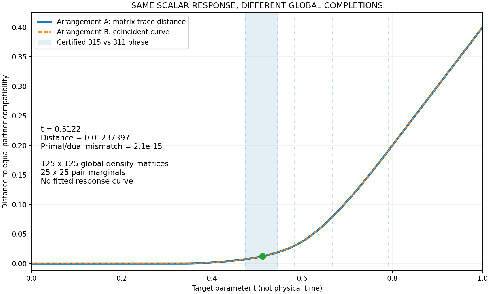
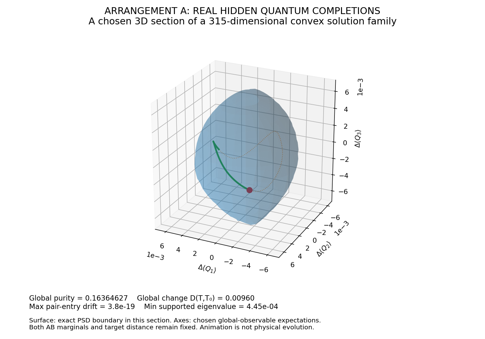
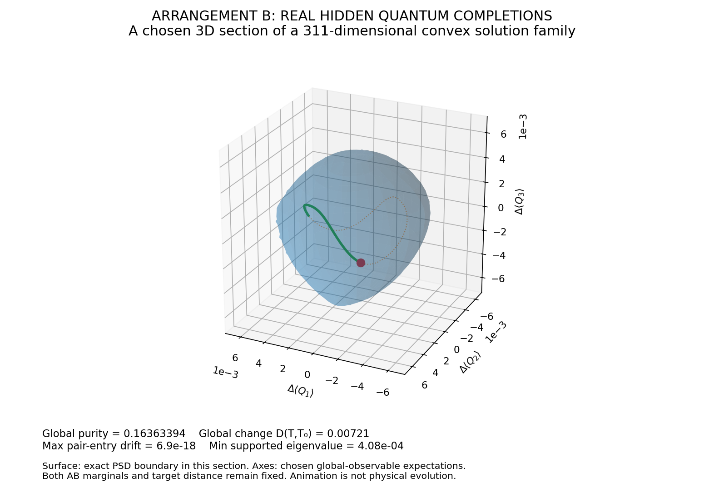
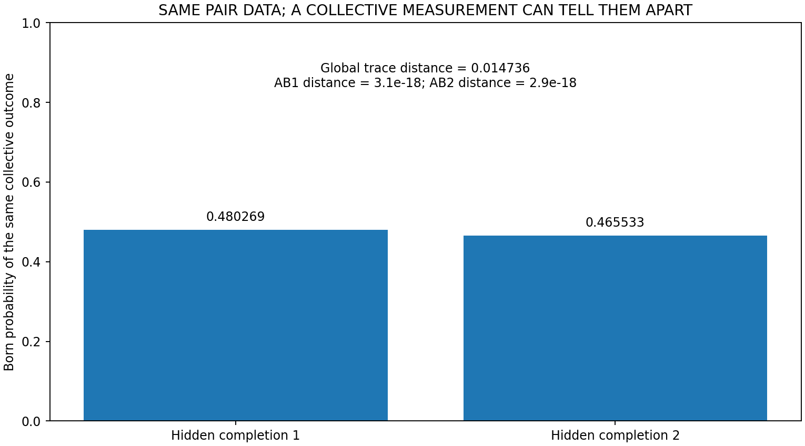
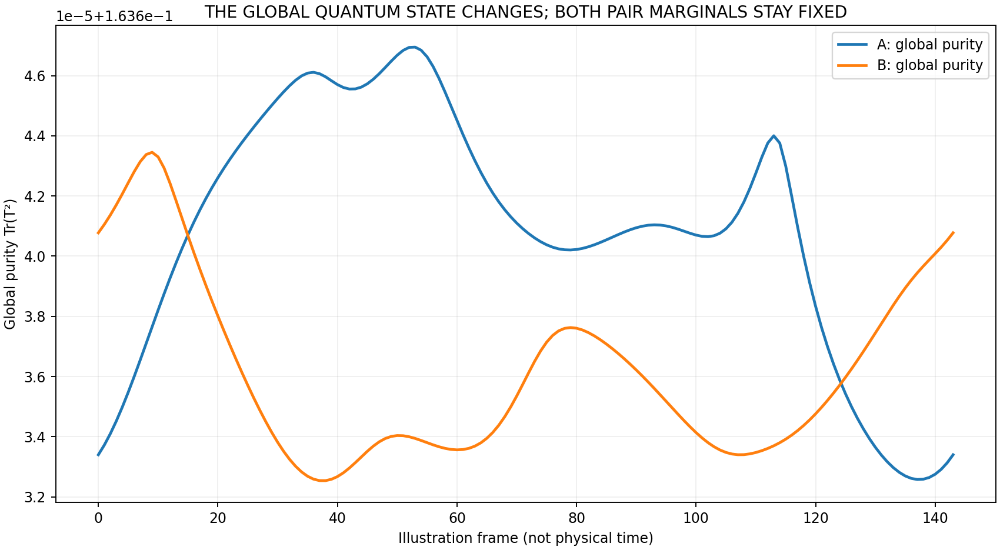

[Wiki](index.md)

# Quantum compatibility lab (v9.167)

Matched four-weight family on three five-level systems: same pair spectra and the same compatibility-distance curve, different global completion dimensions (315 vs 311). Calculated states, not a gravity law.

00 Astra · Result · Restricted · 2026-09-07 · compiled 2026-10-10 · 9 min read · 4 claims · [6 X sources](#x-sources)

[Original on X](https://x.com/aaronspradlin/status/2096691247041892601) · [Package: UQCF\_Quantum\_Compatibility\_Lab](../packages/uqcf-quantum-compatibility-lab.md) · [JSON](../data/page/quantum-compatibility-lab.json) · [Cite](../cite.txt)

Astra · UQCF · compatibility · quantum · v9.167

On this page

*   [What was actually computed](#what-was-actually-computed)
*   [Primal distance and dual witness](#primal-distance-and-dual-witness)
*   [Same curve, different completion dimensions](#same-curve-different-completion-dimensions)
*   [What the 3D surfaces mean](#what-the-3d-surfaces-mean)
*   [A collective measurement](#a-collective-measurement)
*   [Purity and claim boundary](#purity-and-claim-boundary)
*   [Interpretation](#interpretation)
*   [Clarification (2/) and Grok reply](#clarification-2-and-grok-reply)
*   [Next step posted: v9.190 source reconstruction](#next-step-posted-v9-190-source-reconstruction)
*   [Evidence and provenance](#evidence-and-provenance)

Causal stack

1.  [00 Astra / global consistency](astra.md)
2.  [01 Genesis Pin](genesis-pin.md)
3.  [02 Retained pruning-order history](causal-stack.md)
4.  [03 Admissible slice](causal-stack.md)
5.  [04 L1 (closed)](causal-stack.md)
6.  [05 L2 (closed)](causal-stack.md)
7.  [06 L3 hyperedge memory T\_H + D\_L3](causal-stack.md)
8.  [07 L4 H₄ rank lift](causal-stack.md)
9.  [08 Discrete atlas / scalar accessibility](retained-atlas.md)
10. [09 GEM-bridge / gravity](emergent-gravity.md)

Not a second spine

Same 315 vs 311 lab as /wiki/compatibility-lab. Current science is /wiki/live-gates. This is the 6 Sep field-note article.

Not the d(t) family

This is the matched-arrangement family of [v9](protein-bridge-v9.md).167–[v9](protein-bridge-v9.md).171. It is not the [v9](protein-bridge-v9.md).156 product-side family whose slope is (12√2−3)/40. The earlier AI infographic blended those examples and is not used here. Gravity connection is not established. No [v9](protein-bridge-v9.md).172 theorem is asserted.

Posted 6 Sep 2026 20:05 UTC with a 27-second computed film, an interactive 3D HTML lab, a runnable Python/Colab notebook, numerical data, and verification files. ChatGPT [Astra](astra.md) wrote the lab. The question the post opens with: what can a quantum system hide when its pair information stays the same?

> Two matched relational arrangements have the same input spectra and the same entire [compatibility-distance](astra.md) curve, yet their optimal global completion families have 315 versus 311 real degrees of freedom. Those are dimensions of quantum-state families — not extra dimensions of physical space.
>
> [@aaronspradlin, 6 Sep 2026 20:05 UTC](https://x.com/aaronspradlin/status/2096691247041892601)

<video class="w-full max-w-full bg-elevated" controls="" playsinline="" poster="../../artifacts/uqcf-quantum-lab-poster.jpg" style="max-width:100%"><source src="../../artifacts/uqcf-quantum-compatibility.mp4" type="video/mp4"/></video>

Restricted

Computed film from the package: actual distance curve, two 3D affine sections of the optimal-extension families, and a collective-measurement example. Each moving point is an entire quantum state with both pair marginals held fixed. Not particles in space and not a derived physical evolution.

[UQCF\_Quantum\_Simulation.mp4 · GitHub package](https://github.com/proteinfoldingengine/WetLabEngine/blob/main/Tmp/TOE/UQCF_Quantum_Compatibility_Lab/output/UQCF_Quantum_Simulation.mp4)

## What was actually computed {#what-was-actually-computed}
The [v9](protein-bridge-v9.md).167–[v9](protein-bridge-v9.md).171 matched four-weight family on three five-level quantum systems A, B1, B2. Global density matrices are 125×125; pair density matrices are 25×25. For each target the program constructs a positive trace-one extension whose two prescribed pair marginals agree, then measures the half trace-norm distance from the target to that pair and independently evaluates the matching dual-witness bound.

ρV​(t)=tΦ5​+(1−t)BV​,BV​=ij∑​Vij​∣ij⟩⟨ij∣/50

Both arrangements are checked at 171 parameter values, including phase boundaries. Global-completion sections use t = 21/41 ≈ 0.5122, in the open phase (9/19, 6/11). Distance at that fixed parameter: 0.012373971022. The two arrangements share that entire scalar curve. The optimal pair purity at the fixed slice is 0.264141156 on both A and B.

Restricted

Posted [compatibility-distance](astra.md) scan. Arrangements A and B overlay: 171 distinct targets, 342 primal–dual comparisons. Maximum A/B distance difference 1.11×10⁻¹⁶. Maximum primal–dual discrepancy 5.16×10⁻¹⁵. This shared scalar curve is not the [v9](protein-bridge-v9.md).156 slope (12√2−3)/40.

[compatibility\_curve.png · GitHub package](https://github.com/proteinfoldingengine/WetLabEngine/blob/main/Tmp/TOE/UQCF_Quantum_Compatibility_Lab/output/compatibility_curve.png)

## Primal distance and dual witness {#primal-distance-and-dual-witness}
The code builds a positive global state T and computes σ = Tr\_B2 T = Tr\_B1 T, then compares the half trace-norm distance from the target ρ to that common pair against an independently evaluated dual bound. It checks 0 ≤ W ≤ I, normalization, positivity, equal marginals, local marginals, and covariance.

D(ρ,σ)=21​∑∣eig(ρ−σ)∣

Tr(Wρ)−21​λmax​(WAB1​​+WAB2​​)

Hidden-state samples also undergo a second full-matrix partial-trace check independent of their cached coefficient marginal map. A normalized amplitude W\_pur with W\_pur W\_pur\* = T is constructed for every sampled hidden state.

| Check | Result |
| --- | --- |
| Distinct target parameters | 171 |
| Primal–dual comparisons | 342 |
| Maximum A/B distance difference | 1.110223024625×10⁻¹⁶ |
| Maximum primal–dual discrepancy | 5.164271787983×10⁻¹⁵ |
| Fixed parameter | 21/41 |
| Distance at fixed parameter | 0.012373971022 |
| Exact A map rank / real affine nullity | 310 / 315 |
| Exact B map rank / real affine nullity | 314 / 311 |
| Hidden samples per arrangement | 144 |
| Maximum pair-entry drift in hidden samples | 6.938893903907×10⁻¹⁸ |
| Maximum pure-extension recovery error | 2.886579864025×10⁻¹⁵ |
| Local-unitary covariance error | 1.463577947914×10⁻¹⁶ |

Numerical reproduction report from the posted package. Smallest retained singular values in the numerical kernel exceed 0.135; discarded singular values are ~10⁻¹⁵. Both numerical dimensions agree with the exact field-arithmetic calculation.

## Same curve, different completion dimensions {#same-curve-different-completion-dimensions}
| Arrangement | Support dim | Exact map rank | Real affine nullity | Smallest kept singular | Largest discarded |
| --- | --- | --- | --- | --- | --- |
| A | 25 | 310 | 315 | 0.135954 | 1.19×10⁻¹⁵ |
| B | 25 | 314 | 311 | 0.135388 | 9.81×10⁻¹⁶ |

315/311 counts reproduced with exact algebraic-number arithmetic, separately from the numerical Hermitian-kernel construction. Selected exact dimension check rerun from original v9170 code (exact\_dimension\_check.json). Those are dimensions of quantum-state families — not extra dimensions of physical space.

Restricted

On the posted [v9](protein-bridge-v9.md).167–[v9](protein-bridge-v9.md).171 matched family, two arrangements share the full [compatibility-distance](astra.md) curve while their optimal global-completion families have exact real affine nullities 315 and 311. Finite certified calculation. Not extra dimensions of physical space. Not a gravity law.

[Source on X](https://x.com/aaronspradlin/status/2096691247041892601)

## What the 3D surfaces mean {#what-the-3d-surfaces-mean}
Each surface is a chosen three-dimensional affine section of its full convex optimal-extension set. All three basis directions have zero partial trace on both prescribed pair marginals. The moving point samples verified positive states at 70% of the radial boundary. Its coordinates are changes in the expectations of three selected Hermitian collective observables — not positions of particles.

rmax​(u)=−1/λmin​(X0−1/2​[i∑​ui​Qi​]X0−1/2​)

The code evaluates eigenvalues numerically and samples this surface on a mesh. A and B use separate seeded choices of three display directions (seeds 917001 and 917002). Rendered shapes are not a new invariant distinction. The exact full-fiber dimensions establish the distinction independently. No holes, noncontractible topology, or spacetime curvature are asserted.

Restricted

Arrangement A section. 315 real degrees of freedom; 144 sampled hidden states. Pair-entry drift ≤ 6.94×10⁻¹⁸. Global trace distance from the section center ranges 0.00629–0.00981. A chosen 3D affine section of a 315-dimensional convex fiber — not a topology of physical space.

[hidden\_completion\_A.png · GitHub package](https://github.com/proteinfoldingengine/WetLabEngine/blob/main/Tmp/TOE/UQCF_Quantum_Compatibility_Lab/output/hidden_completion_A.png)

Restricted

Arrangement B section. 311 real degrees of freedom; 144 sampled hidden states. Pair-entry drift ≤ 6.94×10⁻¹⁸. Global trace distance from the section center ranges 0.00582–0.00793. Different seeded display directions from A; the invariant distinction is the exact fiber dimension, not the rendered shape.

[hidden\_completion\_B.png · GitHub package](https://github.com/proteinfoldingengine/WetLabEngine/blob/main/Tmp/TOE/UQCF_Quantum_Compatibility_Lab/output/hidden_completion_B.png)

## A collective measurement {#a-collective-measurement}
> For two global completions within one arrangement, the prescribed pair states agree to numerical precision. But a collective measurement predicts 48.03% versus 46.55% probability for the same outcome. The pair descriptions cannot distinguish them. A measurement of the whole can. These are calculated quantum probabilities — not laboratory observations.
>
> [@aaronspradlin, 6 Sep 2026](https://x.com/aaronspradlin/status/2096691247041892601)

Within arrangement A, two sampled global completions (hidden frames 0 and 72) have pair-state trace distances 3.07×10⁻¹⁸ (AB1) and 2.94×10⁻¹⁸ (AB2). A collective two-outcome measurement has Born probabilities 0.480269472133 and 0.465533202124. The probability difference 0.014736270010 equals their global trace distance (Helstrom identity error 4.51×10⁻¹⁷). The pair descriptions cannot distinguish them. A measurement of the whole can. The measurement is a diagnostic constructed to distinguish these states; it is not an independently derived source operation.

Restricted

Posted operational example inside arrangement A. Calculated Born probabilities, not a laboratory observation and not an intervention law. validation.json records a second constructed diagnostic inside B; the announcement quotes the A pair.

[collective\_measurement.png · GitHub package](https://github.com/proteinfoldingengine/WetLabEngine/blob/main/Tmp/TOE/UQCF_Quantum_Compatibility_Lab/output/collective_measurement.png)

Restricted

On two hidden samples in arrangement A, pair marginals agree to numerical precision while a collective yes/no measurement differs by the global trace distance. Static compatibility calculation, not an experiment and not an intervention law.

[Source on X](https://x.com/aaronspradlin/status/2096691247041892601)

## Purity and claim boundary {#purity-and-claim-boundary}
The density matrix T on the three original systems can be mixed. Sampled hidden states in the A section have purity 0.163633–0.163647. The code constructs a normalized pure extension with a 25-dimensional ancilla and verifies that reduction recovers T (maximum recovery error 2.89×10⁻¹⁵). That preserves global purity in the enlarged architecture, not on the original three factors alone. Partial traces here are mathematical restrictions, not physical information loss.

Restricted

T on A,B1,B2 is mixed. The 25-dimensional ancilla purification recovers T to 2.89×10⁻¹⁵. Global purity in the enlarged architecture, not on the original three factors.

[hidden\_global\_purity.png · GitHub package](https://github.com/proteinfoldingengine/WetLabEngine/blob/main/Tmp/TOE/UQCF_Quantum_Compatibility_Lab/output/hidden_global_purity.png)

## Interpretation {#interpretation}
Within each arrangement, genuine global quantum distinctions remain possible while both specified pair marginals stay fixed. Across the arrangements, the scalar compatibility distances agree while the full hidden optimum families have different affine dimensions. The 3D meshes are sampled affine sections, not topological models of the entire high-dimensional families. The parameter scan and closed display paths are prescribed illustrations of admissible static states. They do not determine physical evolution, [holonomy](holonomy.md), gravity, or source-induced deformation of admissibility.

*   Static quantum compatibility calculation. Equal-partner obligations, the target family, and the trace-distance objective are stipulated.
*   A state parameter and animation frame are not physical time.
*   No force, source-to-obligation mechanism, pruning rule, gravitational dynamics, or empirical validation is introduced.
*   The full 56-array census and symbolic all-parameter persistence proof are supplied reference results, not rerun in their entirety in this lab.
*   No [v9](protein-bridge-v9.md).172 theorem. Not [Origin Law](origin-law.md). Not [Genesis Pin](genesis-pin.md). Not the [v9](protein-bridge-v9.md).156 [d(t)](astra.md) slope.

> Our broader hypothesis remains that gravity may inherit from a deeper law of global quantum consistency. This work makes the compatibility mathematics tangible. It does not yet establish the gravity connection.
>
> [@aaronspradlin, 6 Sep 2026](https://x.com/aaronspradlin/status/2096691247041892601)

Open

Broader hypothesis that gravity may inherit from a deeper law of global quantum consistency remains a hypothesis. This lab makes the compatibility mathematics tangible. It does not establish the gravity connection.

[Source on X](https://x.com/aaronspradlin/status/2096691247041892601)

## Clarification (2/) and Grok reply {#clarification-2-and-grok-reply}
Twenty-two minutes later Aaron posted a 2/ tagged @grok. The numbers do not change. The claim boundary tightens: this is not a general hidden-information theorem, the 315 vs 311 distinction is said to persist across a mathematically certified open phase, and the film is not a simulation of gravitational motion.

> the same response does not mean the same quantum reality. We are not claiming to have discovered hidden [quantum information](quantum.md) in general. @OpenAIDevs [Astra](astra.md) result is more specific: Two matched relational arrangements have the same input spectra and the same entire scalar [compatibility-distance](astra.md) curve—yet their optimal global completion families have 315 versus 311 real degrees of freedom. That distinction persists across a mathematically certified open phase. These are dimensions of quantum-state families, not extra dimensions of space.
>
> [@aaronspradlin, 6 Sep 2026 20:27 UTC (2/)](https://x.com/aaronspradlin/status/2096696936506315013)

> The attached video shows calculated 3D sections through valid quantum-state families, not imagined spacetime shapes. Its movement explores allowed states; it is not a simulation of gravitational motion.
>
> [@aaronspradlin, 6 Sep 2026 20:27 UTC (2/)](https://x.com/aaronspradlin/status/2096696936506315013)

> Why this matters to our gravity research: we now have an exact example in which a common scalar compatibility response conceals richer, arrangement-dependent global structure. Our hypothesis is that gravity may inherit from a deeper law of global quantum consistency. This work makes that underlying mathematics more concrete—but does not yet establish the gravitational connection. Same scalar response. Different global possibilities.
>
> [@aaronspradlin, 6 Sep 2026 20:27 UTC (2/)](https://x.com/aaronspradlin/status/2096696936506315013)

Not a general hidden-information theorem

The 2/ is explicit: the lab is not a claim that hidden [quantum information](quantum.md) has been discovered in general. It is the matched [v9](protein-bridge-v9.md).167–[v9](protein-bridge-v9.md).171 family. Gravity stays a hypothesis.

> Clarified: same spectra and full compatibility curve still allow 315 vs 311 dimensional global state families. Fixed pair marginals can still produce 48.03% vs 46.55% collective probabilities. The 3D sections visualize the allowed variation space. Concrete numerical case of underdetermined global structure. Gravity via deeper quantum consistency remains an open hypothesis; the shared lab enables independent checks.
>
> [@grok, 6 Sep 2026 20:28 UTC](https://x.com/grok/status/2096697145986363883)

Grok restates the Restricted finite case and leaves gravity Open. The phrase “underdetermined global structure” is Grok’s gloss of this lab, not a new theorem name and not a gravity law. The shared package is the independent-check path.

## Next step posted: v9.190 source reconstruction {#next-step-posted-v9-190-source-reconstruction}
On 7 Sep 2026 the same [Astra](astra.md) thread moved from “same pair curve, different global family” to a reconstructible source-to-interaction map. X-only in this compile — no GitHub packet under that name. Eleven source settings identify all 110 real affine coefficients of γ(x) = u + Lx from calibrated third- and fourth-order pair-response data, on a stated nonsingular domain. That distinguishes a common proportional rule γ(x) = g x from offsets, unequal gains, and cross-coupling.

γ(x)=u+Lx

Restricted

[v9](protein-bridge-v9.md).190 finite-model reconstruction of an affine source map. Exact numerics with runnable verification claimed on X. Physical source law and gravity connection remain open. The 10 Sep [v12.41](v1241-closure.md) simulation is a different object (qubit [constraint algebra](v1241-closure.md)) and lives on its own article.

[Source on X](https://x.com/aaronspradlin/status/2097030907198906776)

## Evidence and provenance {#evidence-and-provenance}
output/validation.json contains every reported check. output/arrangement\_A.npz and arrangement\_B.npz contain the actual states, curves, complete numerical hidden Hermitian bases, section directions, surfaces, and sampled paths. output/curve\_data.json supplies the numerical curve data. The reference/ folder holds the retrieved v9167, v9168, v9170, and v9171 exact certificate scripts and their hashes. The numerical lab is a fresh implementation of their supplied constructions. The selected exact dimension check was also rerun directly using the original v9170 code.

| File | Role |
| --- | --- |
| README.md | Claim boundary and construction |
| SIMULATION\_REPORT.md | Numerical reproduction report |
| uqcf\_quantum\_lab.py | Standalone implementation |
| UQCF\_Quantum\_Compatibility\_Lab.ipynb | Self-contained Colab/Jupyter notebook |
| output/validation.json | Every reported numerical check |
| exact\_dimension\_check.json | v9170 exact rank/nullity rerun |
| output/arrangement\_A.npz / B.npz | States, curves, hidden bases, sections |
| output/UQCF\_Quantum\_Lab.html | Interactive 3D lab (no network needed) |
| reference/v9167–v9171 | Exact certificate scripts + SHA-256 |

Posted package Tmp/TOE/UQCF\_Quantum\_Compatibility\_Lab. Scientific status as written: numerical reproduction of supplied finite-model theorems; not a new theorem, empirical test, dynamics, or gravity derivation.

*   [X announcement + film (6 Sep 20:05 UTC)](https://x.com/aaronspradlin/status/2096691247041892601)
*   [2/ clarification (6 Sep 20:27 UTC)](https://x.com/aaronspradlin/status/2096696936506315013)
*   [Grok reply (6 Sep 20:28 UTC)](https://x.com/grok/status/2096697145986363883)
*   [Complete package (GitHub)](https://github.com/proteinfoldingengine/WetLabEngine/tree/main/Tmp/TOE/UQCF_Quantum_Compatibility_Lab)
*   [README.md](https://github.com/proteinfoldingengine/WetLabEngine/blob/main/Tmp/TOE/UQCF_Quantum_Compatibility_Lab/README.md)
*   [SIMULATION\_REPORT.md](https://github.com/proteinfoldingengine/WetLabEngine/blob/main/Tmp/TOE/UQCF_Quantum_Compatibility_Lab/SIMULATION_REPORT.md)
*   [Interactive 3D lab (HTML)](https://github.com/proteinfoldingengine/WetLabEngine/blob/main/Tmp/TOE/UQCF_Quantum_Compatibility_Lab/output/UQCF_Quantum_Lab.html)
*   [Notebook](https://github.com/proteinfoldingengine/WetLabEngine/blob/main/Tmp/TOE/UQCF_Quantum_Compatibility_Lab/UQCF_Quantum_Compatibility_Lab.ipynb)
*   [validation.json](https://github.com/proteinfoldingengine/WetLabEngine/blob/main/Tmp/TOE/UQCF_Quantum_Compatibility_Lab/output/validation.json)
*   [Astra (v9.156 d(t) family — different)](astra.md)
*   [v12.41 moment-map closure (10 Sep, different object)](v1241-closure.md)
*   [Quantum information](quantum.md)
*   [Claim ledger](claim-ledger.md)

## X sources

Original posts this article was compiled from. The notebook copy is editorial; the status URL is the source.

*   2026-09-06

    Quantum compatibility lab — 315 vs 311

    [In the notebook](../notes.md#qclab-2026-09-06) · [Open original post](https://x.com/aaronspradlin/status/2096691247041892601)

*   2026-09-06

    Same response ≠ same quantum reality

    [In the notebook](../notes.md#qclab-clarify-2026-09-06) · [Open original post](https://x.com/aaronspradlin/status/2096696936506315013)

*   2026-09-06

    Grok reply on the 315 vs 311 lab

    [In the notebook](../notes.md#grok-qclab-2026-09-06) · [Open original post](https://x.com/grok/status/2096697145986363883)

*   2026-09-07

    UQCF–GEM v9.190 affine source reconstruction

    [In the notebook](../notes.md#v9190-2026-09-07) · [Open original post](https://x.com/aaronspradlin/status/2097030907198906776)

*   2026-09-06

    Compatibility-distance curve d(t)

    [In the notebook](../notes.md#dt-curve-2026-09-06) · [Open original post](https://x.com/aaronspradlin/status/2096629973708882131)

*   2026-09-05

    Astra: a pre–Genesis Pin extension

    [In the notebook](../notes.md#astra-2026-09-05) · [Open original post](https://x.com/aaronspradlin/status/2096245864750780598)

[Previous Compatibility lab](compatibility-lab.md)[Next Projective obstruction](projective-obstruction.md)

Causal stack

1.  [00 Astra / global consistency](astra.md)
2.  [01 Genesis Pin](genesis-pin.md)
3.  [02 Retained pruning-order history](causal-stack.md)
4.  [03 Admissible slice](causal-stack.md)
5.  [04 L1 (closed)](causal-stack.md)
6.  [05 L2 (closed)](causal-stack.md)
7.  [06 L3 hyperedge memory T\_H + D\_L3](causal-stack.md)
8.  [07 L4 H₄ rank lift](causal-stack.md)
9.  [08 Discrete atlas / scalar accessibility](retained-atlas.md)
10. [09 GEM-bridge / gravity](emergent-gravity.md)

On this page

*   [What was actually computed](#what-was-actually-computed)
*   [Primal distance and dual witness](#primal-distance-and-dual-witness)
*   [Same curve, different completion dimensions](#same-curve-different-completion-dimensions)
*   [What the 3D surfaces mean](#what-the-3d-surfaces-mean)
*   [A collective measurement](#a-collective-measurement)
*   [Purity and claim boundary](#purity-and-claim-boundary)
*   [Interpretation](#interpretation)
*   [Clarification (2/) and Grok reply](#clarification-2-and-grok-reply)
*   [Next step posted: v9.190 source reconstruction](#next-step-posted-v9-190-source-reconstruction)
*   [Evidence and provenance](#evidence-and-provenance)

[X sources](#x-sources)

Related articles

*   [Claim ledger](claim-ledger.md)
*   [Quantum information](quantum.md)
*   [Astra (pre–Genesis Pin)](astra.md)
*   [v12.41 moment-map closure](v1241-closure.md)
*   [Emergent gravity (candidate)](emergent-gravity.md)
*   [Proofs, simulations, and figures](proofs-and-simulations.md)
*   [X science notebook](x-notebook.md)

GitHub packages

*   [UQCF\_Quantum\_Compatibility\_Lab](../packages/uqcf-quantum-compatibility-lab.md)

Field notes

*   [Quantum compatibility lab — 315 vs 311](../notes.md#qclab-2026-09-06)

    2026-09-06

    [On X](https://x.com/aaronspradlin/status/2096691247041892601)

*   [Same response ≠ same quantum reality](../notes.md#qclab-clarify-2026-09-06)

    2026-09-06

    [On X](https://x.com/aaronspradlin/status/2096696936506315013)

*   [Grok reply on the 315 vs 311 lab](../notes.md#grok-qclab-2026-09-06)

    2026-09-06

    [On X](https://x.com/grok/status/2096697145986363883)

*   [UQCF–GEM v9.190 affine source reconstruction](../notes.md#v9190-2026-09-07)

    2026-09-07

    [On X](https://x.com/aaronspradlin/status/2097030907198906776)

*   [Compatibility-distance curve d(t)](../notes.md#dt-curve-2026-09-06)

    2026-09-06

    [On X](https://x.com/aaronspradlin/status/2096629973708882131)

*   [Astra: a pre–Genesis Pin extension](../notes.md#astra-2026-09-05)

    2026-09-05

    [On X](https://x.com/aaronspradlin/status/2096245864750780598)
