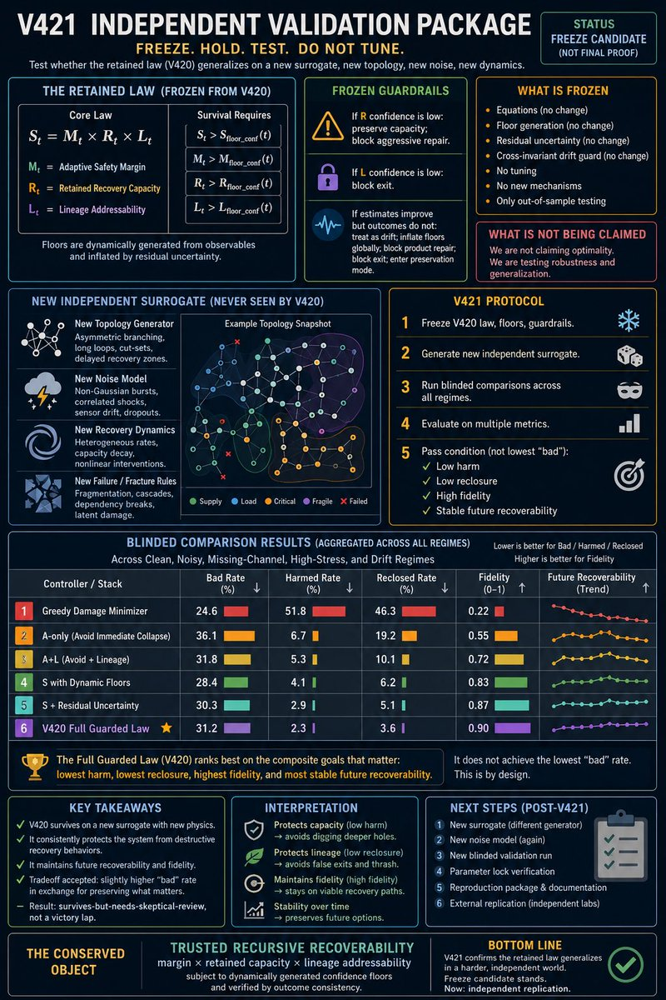
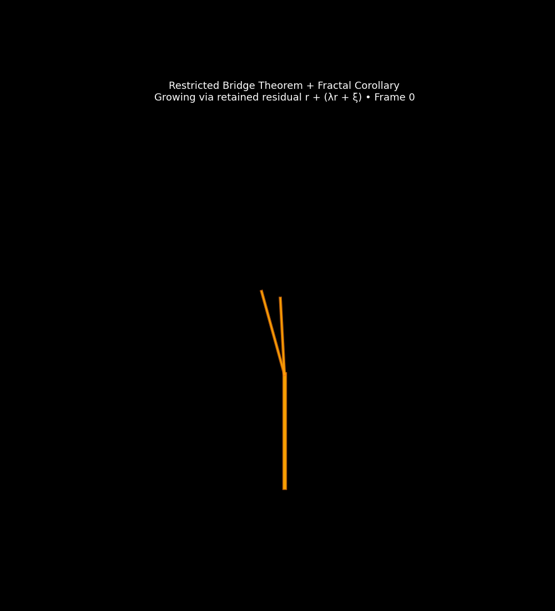

[Wiki](index.md)

# Restricted bridge theorems

Affine coupling, hierarchical selectors, and fractal corollaries — frozen restricted, not universal.

03 Admissible slice · Result · Restricted · 2026-09-06 · compiled 2026-10-10 · 1 min read · 1 claim · [5 X sources](#x-sources)

[Original on X](https://x.com/aaronspradlin/status/2054698197361266981) · [Package: ai\_peer\_review\_bundle\_v1](../packages/ai-peer-review-bundle-v1.md) · [JSON](../data/page/restricted-bridge.json) · [Cite](../cite.txt)

bridge · affine · theorem · fractal

On this page

*   [Bridge-closure status](#bridge-closure-status)
*   [V395 → V421 survival law](#v395-v421-survival-law)

Causal stack

1.  [00 Astra / global consistency](astra.md)
2.  [01 Genesis Pin](genesis-pin.md)
3.  [02 Retained pruning-order history](causal-stack.md)
4.  [03 Admissible slice](causal-stack.md)
5.  [04 L1 (closed)](causal-stack.md)
6.  [05 L2 (closed)](causal-stack.md)
7.  [06 L3 hyperedge memory T\_H + D\_L3](causal-stack.md)
8.  [07 L4 H₄ rank lift](causal-stack.md)
9.  [08 Discrete atlas / scalar accessibility](retained-atlas.md)
10. [09 GEM-bridge / gravity](emergent-gravity.md)

The restricted-bridge program is where the work is most theorem-shaped and most careful. Theorem Packet v27 freezes a hierarchy: a universal compact / admissibility / local-residual layer, then a restricted bridge layer whose strongest draft is a covariance–variance coupling with a robust slope band and an explicit empirical validity region.

ΔCov=a0​ΔVar+b0​+ε

a₀ and b₀ arise from baseline residual geometry; ε is controlled by gain drift, response curvature, and innovation scale. The operational default is a utility-maximizing stack; a balanced operating point is kept only as a softer interpretive alternative.

## Bridge-closure status {#bridge-closure-status}
The consolidated status note no longer treats the bridge as a loose hypothesis. It reports a hierarchical selector (not a flat one), real local seam structure, strong family and perturbation transfer, and a lower weak ladder from nested thresholding of a normalized retained-envelope variable.

Restricted

A retained-state bridge built from normalized residual-envelope coordinates supports a low-complexity hierarchical selector with real local seam structure, strong family and perturbation transfer, renormalizable scale behavior, and a lower weak ladder. This is the strongest admissible bridge claim — not TOE closure.

## V395 → V421 survival law {#v395-v421-survival-law}
A parallel compression: A\_t = M\_t × [R\_t](uqcf-gem.md) was not enough. Immediate recovery did not predict delayed collapse or post-exit fidelity, forcing lineage addressability L\_t and the recursive law S\_t = M\_t × [R\_t](uqcf-gem.md) × L\_t. V421 was a blinded generalization test (new topology, noise, fracture; no coefficient retuning). Greedy minimizers still win short-term bad rate; the retained law minimized harm, false exit, reclosure, lineage destruction, and long-horizon fidelity collapse.

Restricted

V421 blinded generalization: new topology, noise, and fracture; no coefficient retuning. Python, results, and data were posted with the figure.

[@aaronspradlin, 13 May 2026](https://x.com/aaronspradlin/status/2054698197361266981)

Restricted

Restricted-bridge fractal growth GIF from the TOE tree. Restricted corollary, not a universal law.

[restricted\_bridge\_fractal\_growth.gif on GitHub](https://github.com/proteinfoldingengine/WetLabEngine/blob/main/Tmp/TOE/restricted_bridge_fractal_growth.gif)

## X sources

Original posts this article was compiled from. The notebook copy is editorial; the status URL is the source.

*   2026-05-13

    From A\_t to the recursive survival law

    [In the notebook](../notes.md#v395-v421-2026-05-13) · [Open original post](https://x.com/aaronspradlin/status/2054698197361266981)

*   2026-05-14

    V513 conformal recoverability — theorem candidate

    [In the notebook](../notes.md#v513-2026-05-14) · [Open original post](https://x.com/aaronspradlin/status/2054987754552148183)

*   2026-05-10

    Native residual energy predicts repair

    [In the notebook](../notes.md#native-energy-2026-05-10) · [Open original post](https://x.com/aaronspradlin/status/2053524420455813164)

*   2026-05-10

    Retained Branch Identity audit: address map or wipe

    [In the notebook](../notes.md#branch-identity-2026-05-10) · [Open original post](https://x.com/aaronspradlin/status/2053302053947216330)

*   2026-05-14

    V498 retained-geometry Python proof

    [In the notebook](../notes.md#v498-2026-05-14) · [Open original post](https://x.com/aaronspradlin/status/2054767069212901584)

[Previous Recoverability framework](recoverability-framework.md)[Next Package 17 — derivation program](package-17.md)

Causal stack

1.  [00 Astra / global consistency](astra.md)
2.  [01 Genesis Pin](genesis-pin.md)
3.  [02 Retained pruning-order history](causal-stack.md)
4.  [03 Admissible slice](causal-stack.md)
5.  [04 L1 (closed)](causal-stack.md)
6.  [05 L2 (closed)](causal-stack.md)
7.  [06 L3 hyperedge memory T\_H + D\_L3](causal-stack.md)
8.  [07 L4 H₄ rank lift](causal-stack.md)
9.  [08 Discrete atlas / scalar accessibility](retained-atlas.md)
10. [09 GEM-bridge / gravity](emergent-gravity.md)

On this page

*   [Bridge-closure status](#bridge-closure-status)
*   [V395 → V421 survival law](#v395-v421-survival-law)

[X sources](#x-sources)

Related articles

*   [Claim ledger](claim-ledger.md)
*   [UQCF-GEM](uqcf-gem.md)
*   [Package 17 — derivation program](package-17.md)
*   [May 2026 ladder](may-2026-ladder.md)

GitHub packages

*   [ai\_peer\_review\_bundle\_v1](../packages/ai-peer-review-bundle-v1.md)
*   [restricted\_fractal\_publication\_bundle](../packages/restricted-fractal-publication-bundle.md)
*   [final\_bridge\_manuscript\_and\_supporting\_materials](../packages/final-bridge-manuscript-and-supporting-materials.md)
*   [v498\_retained\_geometry\_formal\_report\_package](../packages/v498-retained-geometry-formal-report-package.md)
*   [v395\_full\_stack\_proof\_kit](../packages/v395-full-stack-proof-kit.md)
*   [v421\_independent\_validation\_package](../packages/v421-independent-validation-package.md)

Field notes

*   [From A\_t to the recursive survival law](../notes.md#v395-v421-2026-05-13)

    2026-05-13

    [On X](https://x.com/aaronspradlin/status/2054698197361266981)

*   [V513 conformal recoverability — theorem candidate](../notes.md#v513-2026-05-14)

    2026-05-14

    [On X](https://x.com/aaronspradlin/status/2054987754552148183)

*   [Native residual energy predicts repair](../notes.md#native-energy-2026-05-10)

    2026-05-10

    [On X](https://x.com/aaronspradlin/status/2053524420455813164)

*   [Retained Branch Identity audit: address map or wipe](../notes.md#branch-identity-2026-05-10)

    2026-05-10

    [On X](https://x.com/aaronspradlin/status/2053302053947216330)

*   [V498 retained-geometry Python proof](../notes.md#v498-2026-05-14)

    2026-05-14

    [On X](https://x.com/aaronspradlin/status/2054767069212901584)
