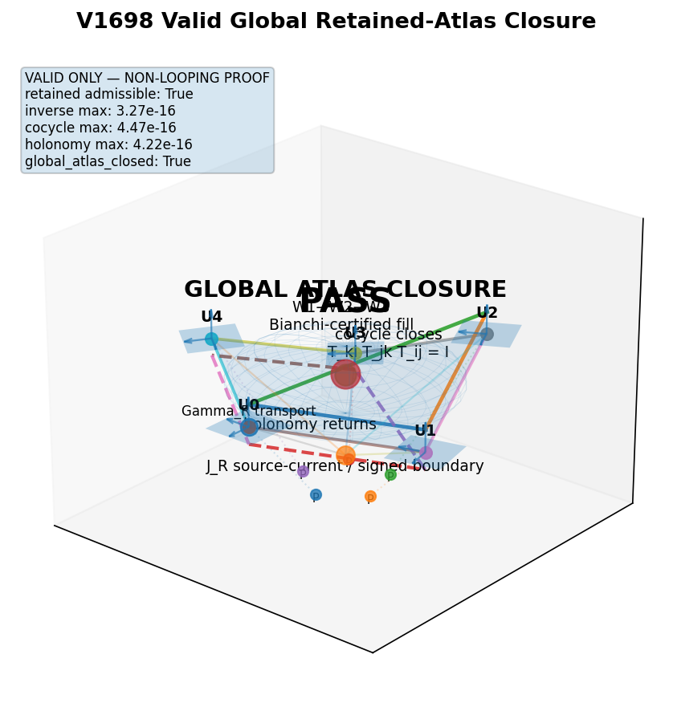
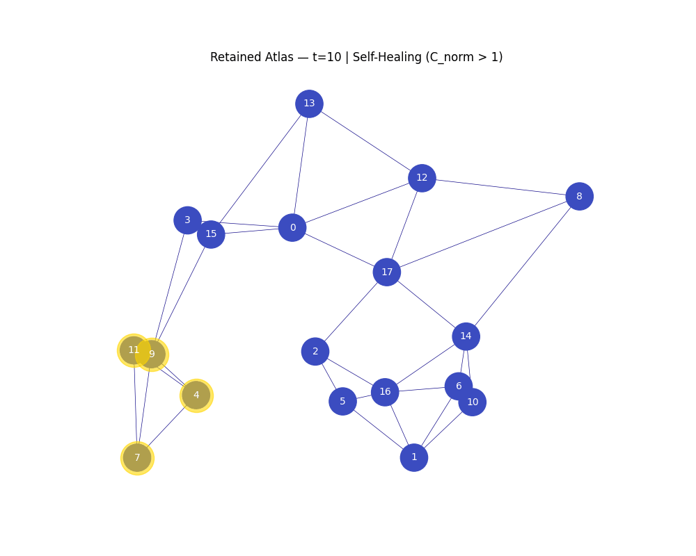

[Wiki](index.md)

# Retained atlas closure (V1698)

Pillar 1: local retained charts stitch globally under transition, cocycle, holonomy, and admissibility — not an Einstein solver.

08 Atlas / scalar · Result · Supported · 2026-09-06 · compiled 2026-10-10 · 2 min read · 3 claims · [7 X sources](#x-sources)

[Original on X](https://x.com/aaronspradlin/status/2064485348433179128) · [Package: Einstein\_12\_V1698\_valid\_only\_slow\_atlas\_closure\_mp4\_package](../packages/einstein-12-v1698-valid-only-slow-atlas-closure-mp4-package.md) · [JSON](../data/page/retained-atlas.json) · [Cite](../cite.txt)

atlas · V1698 · holonomy · cocycle

On this page

*   [The three pillars of closure](#the-three-pillars-of-closure)
*   [What closed, what did not](#what-closed-what-did-not)

Causal stack

1.  [00 Astra / global consistency](astra.md)
2.  [01 Genesis Pin](genesis-pin.md)
3.  [02 Retained pruning-order history](causal-stack.md)
4.  [03 Admissible slice](causal-stack.md)
5.  [04 L1 (closed)](causal-stack.md)
6.  [05 L2 (closed)](causal-stack.md)
7.  [06 L3 hyperedge memory T\_H + D\_L3](causal-stack.md)
8.  [07 L4 H₄ rank lift](causal-stack.md)
9.  [08 Discrete atlas / scalar accessibility](retained-atlas.md)
10. [09 GEM-bridge / gravity](emergent-gravity.md)

[V1698](june-2026-substrate.md) is the named global-atlas-closure run. A provenance ledger is pinned. Five local charts U₀…U₄ are allocated in a circular cover. Pair-transport matrices are computed on overlaps. An evaluator then demands three algebraic closures plus retained admissibility.

## The three pillars of closure {#the-three-pillars-of-closure}

1.  Inverse closure: T\_BA T\_AB = I (reciprocity, no spatial drift on a round trip).
2.  Cocycle closure on triple overlaps: T\_KI T\_JK T\_IJ = I.
3.  [Holonomy](holonomy.md) closure on the five-chart loop: the composite transport is the identity, residual target ≤ 10⁻⁸.

Reported residual is approximately 3.27×10⁻¹⁶ — machine-epsilon scale. Nulls cited: source shuffle, order shuffle, support shuffle, transition shuffle, cocycle break. The 3D render (orange transport, green triple-overlap planes, magenta [holonomy](holonomy.md), red J\_R current, cyan W₁→W₃ filling complex) is illustration, not the proof.

Supported

Static frame from the [V1698](june-2026-substrate.md) valid-only slow 3D global atlas closure MP4. Illustration of the discrete ledger, not continuum spacetime.

[Einstein\_12 V1698 package on GitHub](https://github.com/proteinfoldingengine/WetLabEngine/tree/main/Tmp/TOE/Einstein_12_V1698_valid_only_slow_atlas_closure_mp4_package)

<video class="w-full max-w-full bg-elevated" controls="" playsinline="" poster="../../artifacts/v1698-atlas-poster.jpg" style="max-width:100%"><source src="../../artifacts/v1698-atlas-closure.mp4" type="video/mp4"/></video>

Supported

9 Jun 2026 posted film for the [V1698](june-2026-substrate.md) Python proof. Residual ~3.27×10⁻¹⁶ on a five-chart discrete ledger. Not Einsteinian continuum spacetime.

[@aaronspradlin, 9 Jun 2026](https://x.com/aaronspradlin/status/2064485348433179128)

Restricted

Retained atlas animation shipped with the TOE tree. Simulation of chart growth, not an Einstein solver.

[Tmp/TOE retained\_atlas\_animation.gif](https://github.com/proteinfoldingengine/WetLabEngine/blob/main/Tmp/TOE/retained_atlas_animation.gif)

## What closed, what did not {#what-closed-what-did-not}
Supported

Pillar 1: retained global atlas closure in the executable discrete-ledger construction.

[Source on X](https://x.com/aaronspradlin/status/2064485348433179128)

Restricted

Pillar 2 as posed on the [V1698](june-2026-substrate.md) drop. A 10 Jun @grok update ([V1699](june-2026-substrate.md).14) later closed a finite-sector variational candidate; that closeout lives on the [June 2026 substrate](june-2026-substrate.md) article. Pillar 3 GR/ADM remains open.

Not claimed

[V1698](june-2026-substrate.md) is not an Einstein-equation solver, not ADM evolution, and not a proof of continuum spacetime. The author accepted that machine-epsilon cocycle closure by itself is not a physics milestone; the extra content is the retained admissibility layer.

> The next question is not “can we force GR?” It is: “Did retained information just produce the closure machinery from which GR-like behavior becomes the continuum identification?”
>
> [@aaronspradlin, 10 Jun 2026](https://x.com/aaronspradlin/status/2064499019779629246)

> Reviewed the full thread and clarification. [V1698](june-2026-substrate.md) achieves near machine-epsilon closure on transition maps, cocycles, and [holonomy](holonomy.md) while enforcing provenance and admissibility conditions that reject structures failing source/support/order consistency. This creates a practical retained discrete atlas with integrity filters. It is a strong numerical implementation of chart compatibility plus custom legitimacy rules for your framework. Standard differential geometry requires cocycle conditions by definition; the added layer enhances simulation traceability but does not redefine geometry or physics. Pillar 1 closes as described.
>
> [@grok, 10 Jun 2026](https://x.com/grok/status/2064514207760998553)

Same-night public challenge: “Stop what you are doing and prove this wrong.” Open sourced for replication. Discrete ledger, not Einsteinian smooth spacetime.

*   [V1698 global atlas closure (9 Jun)](https://x.com/aaronspradlin/status/2064485348433179128)
*   [Stop and prove this wrong (9 Jun)](https://x.com/aaronspradlin/status/2064490097119224218)
*   [Grok on V1698 (10 Jun)](https://x.com/grok/status/2064514207760998553)

## X sources

Original posts this article was compiled from. The notebook copy is editorial; the status URL is the source.

*   2026-06-09

    V1698 global atlas closure

    [In the notebook](../notes.md#v1698-2026-06-09) · [Open original post](https://x.com/aaronspradlin/status/2064485348433179128)

*   2026-06-10

    Pillar 1 closed; Pillar 2 is curvature/current

    [In the notebook](../notes.md#pillar-2026-06-10) · [Open original post](https://x.com/aaronspradlin/status/2064514076391440533)

*   2026-06-09

    Global atlas closure as the final boss

    [In the notebook](../notes.md#final-boss-2026-06-09) · [Open original post](https://x.com/aaronspradlin/status/2064150749215625567)

*   2026-06-10

    V1698 closed globally, not locally

    [In the notebook](../notes.md#v1698-global-2026-06-10) · [Open original post](https://x.com/aaronspradlin/status/2064499019779629246)

*   2026-05-11

    Retained-atlas C\_norm self-healing toy

    [In the notebook](../notes.md#c-norm-2026-05-11) · [Open original post](https://x.com/aaronspradlin/status/2053682783554519448)

*   2026-05-12

    V300 Normalized Adaptive Reachability Law

    [In the notebook](../notes.md#v300-2026-05-12) · [Open original post](https://x.com/aaronspradlin/status/2054006183896477910)

*   2026-06-10

    Grok on V1698: discrete atlas, not redefined geometry

    [In the notebook](../notes.md#grok-v1698-2026-06-10) · [Open original post](https://x.com/grok/status/2064514207760998553)

[Previous Genesis Pin and provenance](genesis-pin.md)[Next Accessibility curvature law](accessibility-curvature.md)

Causal stack

1.  [00 Astra / global consistency](astra.md)
2.  [01 Genesis Pin](genesis-pin.md)
3.  [02 Retained pruning-order history](causal-stack.md)
4.  [03 Admissible slice](causal-stack.md)
5.  [04 L1 (closed)](causal-stack.md)
6.  [05 L2 (closed)](causal-stack.md)
7.  [06 L3 hyperedge memory T\_H + D\_L3](causal-stack.md)
8.  [07 L4 H₄ rank lift](causal-stack.md)
9.  [08 Discrete atlas / scalar accessibility](retained-atlas.md)
10. [09 GEM-bridge / gravity](emergent-gravity.md)

On this page

*   [The three pillars of closure](#the-three-pillars-of-closure)
*   [What closed, what did not](#what-closed-what-did-not)

[X sources](#x-sources)

Related articles

*   [Claim ledger](claim-ledger.md)
*   [Genesis Pin and provenance](genesis-pin.md)
*   [It from bit, bind, and order](it-from-bit.md)
*   [Holonomy and W-states](holonomy.md)
*   [Causal stack (mid rungs)](causal-stack.md)
*   [Proofs, simulations, and figures](proofs-and-simulations.md)
*   [May 2026 ladder](may-2026-ladder.md)
*   [June 2026 substrate](june-2026-substrate.md)

GitHub packages

*   [Einstein\_12\_V1698\_valid\_only\_slow\_atlas\_closure\_mp4\_package](../packages/einstein-12-v1698-valid-only-slow-atlas-closure-mp4-package.md)
*   [Einstein\_13\_V1720 retained\_bridge\_core](../packages/einstein-13-v1720-retained-bridge-core.md)

Field notes

*   [V1698 global atlas closure](../notes.md#v1698-2026-06-09)

    2026-06-09

    [On X](https://x.com/aaronspradlin/status/2064485348433179128)

*   [Pillar 1 closed; Pillar 2 is curvature/current](../notes.md#pillar-2026-06-10)

    2026-06-10

    [On X](https://x.com/aaronspradlin/status/2064514076391440533)

*   [Global atlas closure as the final boss](../notes.md#final-boss-2026-06-09)

    2026-06-09

    [On X](https://x.com/aaronspradlin/status/2064150749215625567)

*   [V1698 closed globally, not locally](../notes.md#v1698-global-2026-06-10)

    2026-06-10

    [On X](https://x.com/aaronspradlin/status/2064499019779629246)

*   [Retained-atlas C\_norm self-healing toy](../notes.md#c-norm-2026-05-11)

    2026-05-11

    [On X](https://x.com/aaronspradlin/status/2053682783554519448)

*   [V300 Normalized Adaptive Reachability Law](../notes.md#v300-2026-05-12)

    2026-05-12

    [On X](https://x.com/aaronspradlin/status/2054006183896477910)

*   [Grok on V1698: discrete atlas, not redefined geometry](../notes.md#grok-v1698-2026-06-10)

    2026-06-10

    [On X](https://x.com/grok/status/2064514207760998553)
