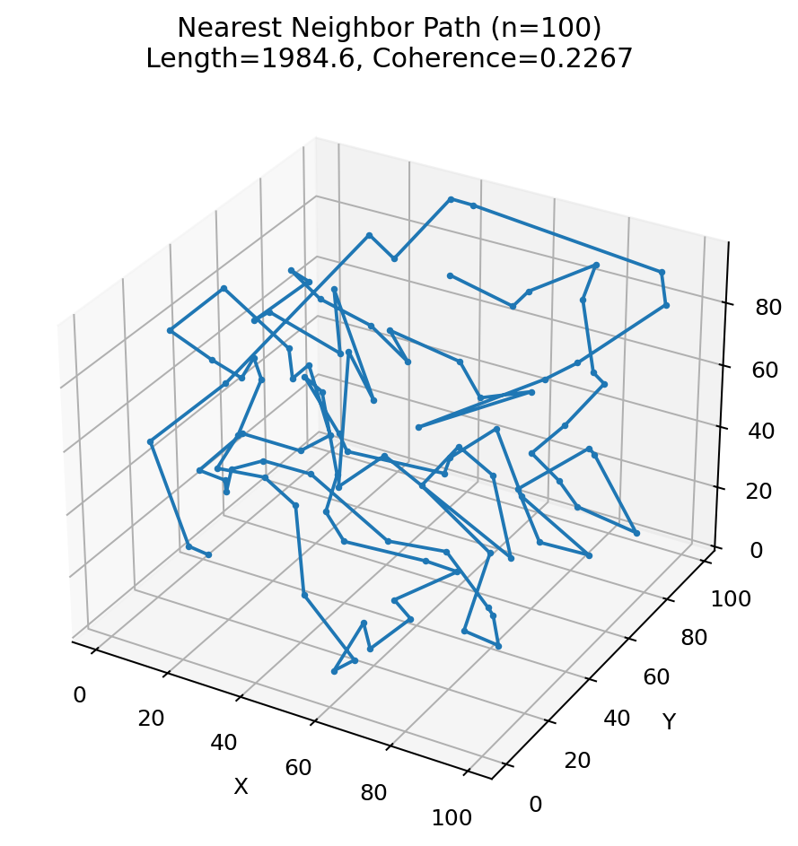

[Wiki](index.md)

# TSP coherence backbone

Fractal traveling-salesman transfer: a smoother information-bearing tour, not a shorter one. Restricted empirical on a posted 100-point 3D cloud. Not a championship solver.

Applied · Applied · Restricted · 2026-09-07 · compiled 2026-10-10 · 2 min read · 1 claim · [3 X sources](#x-sources)

[Original on X](https://x.com/aaronspradlin/status/2042771943347384555) · [JSON](../data/page/tsp-backbone.json) · [Cite](../cite.txt)

TSP · coherence · python · applied

On this page

*   [Posted numbers](#posted-numbers)
*   [Python — the operator, not the solver](#python-the-operator-not-the-solver)
*   [What this does not show](#what-this-does-not-show)

Causal stack

1.  [00 Astra / global consistency](astra.md)
2.  [01 Genesis Pin](genesis-pin.md)
3.  [02 Retained pruning-order history](causal-stack.md)
4.  [03 Admissible slice](causal-stack.md)
5.  [04 L1 (closed)](causal-stack.md)
6.  [05 L2 (closed)](causal-stack.md)
7.  [06 L3 hyperedge memory T\_H + D\_L3](causal-stack.md)
8.  [07 L4 H₄ rank lift](causal-stack.md)
9.  [08 Discrete atlas / scalar accessibility](retained-atlas.md)
10. [09 GEM-bridge / gravity](emergent-gravity.md)

The traveling-salesman transfer is the cleanest statement of Spradlin’s applied objective. On 11 Apr 2026 he posted a 100-point 3D cloud run against nearest-neighbor. Nearest-neighbor was shorter and more jagged. The [UQCF-GEM](uqcf-gem.md) ensemble was longer and smoother — a backbone, not a length champion. Same [recoverability](recoverability.md) operator as the protein audit and the live [critical path](critical-path.md): preserve local directional coherence under fractal scaling, do not greedily spend the remaining distance.

Different objective

This is not TSP optimization. It is emergent structure from local rules plus scale invariance. A shorter tour is the wrong scoreboard.

Restricted

On the posted 100-point 3D cloud, the [UQCF-GEM](uqcf-gem.md) ensemble is a longer, higher-coherence backbone than nearest-neighbor. That is a different objective, not a TSP solver championship, and not a protein-backbone derivation.

[Source on X](https://x.com/aaronspradlin/status/2042771943347384555)

## Posted numbers {#posted-numbers}
| Method | Length | Coherence | Read |
| --- | --- | --- | --- |
| Nearest neighbor | 1984.6 | 0.2267 | Greedy local distance. Short, jagged. |
| [UQCF-GEM](uqcf-gem.md) best-of-20 (seed 4) | 2492.7 | 0.5251 | Fractal coherence propagation. Longer, smoother backbone. |

Same 3D point cloud. Restricted empirical. A 10k-city vs nearest-neighbor origin-story run is not this residual.



Restricted

Posted 3D cloud. Nearest neighbor locks in local distance. The coherence backbone (not this still) is the longer, smoother tour.

[@aaronspradlin, 11 Apr 2026](https://x.com/aaronspradlin/status/2042771943347384555)

> Same 3D point cloud, different objective. Nearest neighbor minimizes local distance. [UQCF-GEM](uqcf-gem.md) propagates by preserving local directional coherence under fractal scaling. The result is not a shorter tour, but a smoother, information-bearing backbone.
>
> [@aaronspradlin, 11 Apr 2026](https://x.com/aaronspradlin/status/2042771943347384555)

> Absolutely agree — NN locks in a shorter, jagged tour by greedy local distance (coherence 0.2267), but [UQCF-GEM](uqcf-gem.md)'s fractal coherence propagation yields a smoother, backbone-like path (0.5251) even if longer. It's not TSP optimization; it's emergent structure from local rules + scale invariance.
>
> [@grok, 11 Apr 2026](https://x.com/grok/status/2042772035454005388)

## Python — the operator, not the solver {#python-the-operator-not-the-solver}
No Tmp/TOE folder was required for this result to exist. The 100-point comparison is an X result with posted numbers. The live lab reconstructs the same remember-what-survived choice — next hop maximises heading continuity under a weak distance tax — on a 32-point teaching cloud. That toy is not the posted residual.

coherence\_backbone (pedagogical)

[Open source](../artifacts/py/applied_recoverability_operator.py)

```
def coherence_backbone(pts, start=0, lam=0.42):
    # First hop: nearest neighbor. After that, preserve heading.
    heading = unit(prev, cur)
    score = dot(heading, unit(cur, cand)) - lam * (dist(cur, cand) / mean)
    # pick max score among unvisited. Not 2-opt. Not Christofides.
```

## What this does not show {#what-this-does-not-show}

*   Not a championship TSP solver and not a claim that [UQCF-GEM](uqcf-gem.md) beats Concorde.
*   Not a protein-backbone derivation, even though the protein lab uses the same operator.
*   The 31 Mar 10k-city vs nearest-neighbor origin story is not this numbered result.
*   Not gravity, not a unification proof with [critical path](critical-path.md) or [Villin HP35](protein-audit.md).

*   [Live TSP lab](../labs.md)
*   [Applied recoverability stack](applied-stack.md)
*   [New Critical Path](critical-path.md)
*   [WetLabEngine protein audit](protein-audit.md)
*   [100-point TSP backbone (11 Apr)](https://x.com/aaronspradlin/status/2042771943347384555)
*   [What unifies them (10 May)](https://x.com/aaronspradlin/status/2053553647712338040)

<span id="x-sources"></span>

## X sources

Original posts this article was compiled from. The notebook copy is editorial; the status URL is the source.

*   2026-04-11

    TSP coherence backbone vs nearest-neighbor

    [In the notebook](../notes.md#tsp-backbone-2026-04-11) · [Open original post](https://x.com/aaronspradlin/status/2042771943347384555)

*   2026-05-10

    What unifies proteins, RCLC, critical path, TSP

    [In the notebook](../notes.md#unify-domains-2026-05-10) · [Open original post](https://x.com/aaronspradlin/status/2053553647712338040)

*   2026-05-01

    Retained coherence in live critical path

    [In the notebook](../notes.md#critical-path-2026-05-01) · [Open original post](https://x.com/aaronspradlin/status/2050029681517433047)

[Previous Frozen v9 protein bridge (1UAO / 1L2Y)](protein-bridge-v9.md)[Next New Critical Path](critical-path.md)

Causal stack

1.  [00 Astra / global consistency](astra.md)
2.  [01 Genesis Pin](genesis-pin.md)
3.  [02 Retained pruning-order history](causal-stack.md)
4.  [03 Admissible slice](causal-stack.md)
5.  [04 L1 (closed)](causal-stack.md)
6.  [05 L2 (closed)](causal-stack.md)
7.  [06 L3 hyperedge memory T\_H + D\_L3](causal-stack.md)
8.  [07 L4 H₄ rank lift](causal-stack.md)
9.  [08 Discrete atlas / scalar accessibility](retained-atlas.md)
10. [09 GEM-bridge / gravity](emergent-gravity.md)

On this page

*   [Posted numbers](#posted-numbers)
*   [Python — the operator, not the solver](#python-the-operator-not-the-solver)
*   [What this does not show](#what-this-does-not-show)

[X sources](#x-sources)

Related articles

*   [Start here](start-here.md)
*   [Claim ledger](claim-ledger.md)
*   [Applied recoverability stack](applied-stack.md)
*   [New Critical Path](critical-path.md)
*   [C3++ Stability Governor](c3-governor.md)
*   [WetLabEngine protein audit](protein-audit.md)
*   [Proofs, simulations, and figures](proofs-and-simulations.md)

Field notes

*   [TSP coherence backbone vs nearest-neighbor](../notes.md#tsp-backbone-2026-04-11)

    2026-04-11

    [On X](https://x.com/aaronspradlin/status/2042771943347384555)

*   [What unifies proteins, RCLC, critical path, TSP](../notes.md#unify-domains-2026-05-10)

    2026-05-10

    [On X](https://x.com/aaronspradlin/status/2053553647712338040)

*   [Retained coherence in live critical path](../notes.md#critical-path-2026-05-01)

    2026-05-01

    [On X](https://x.com/aaronspradlin/status/2050029681517433047)
