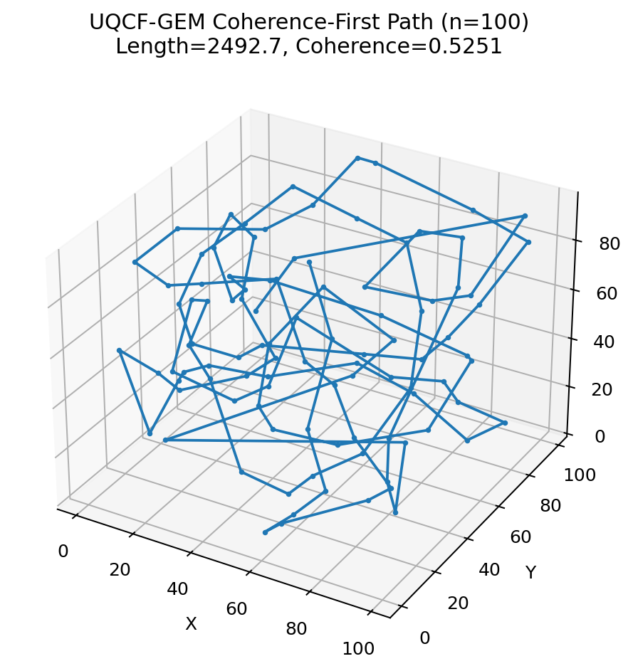
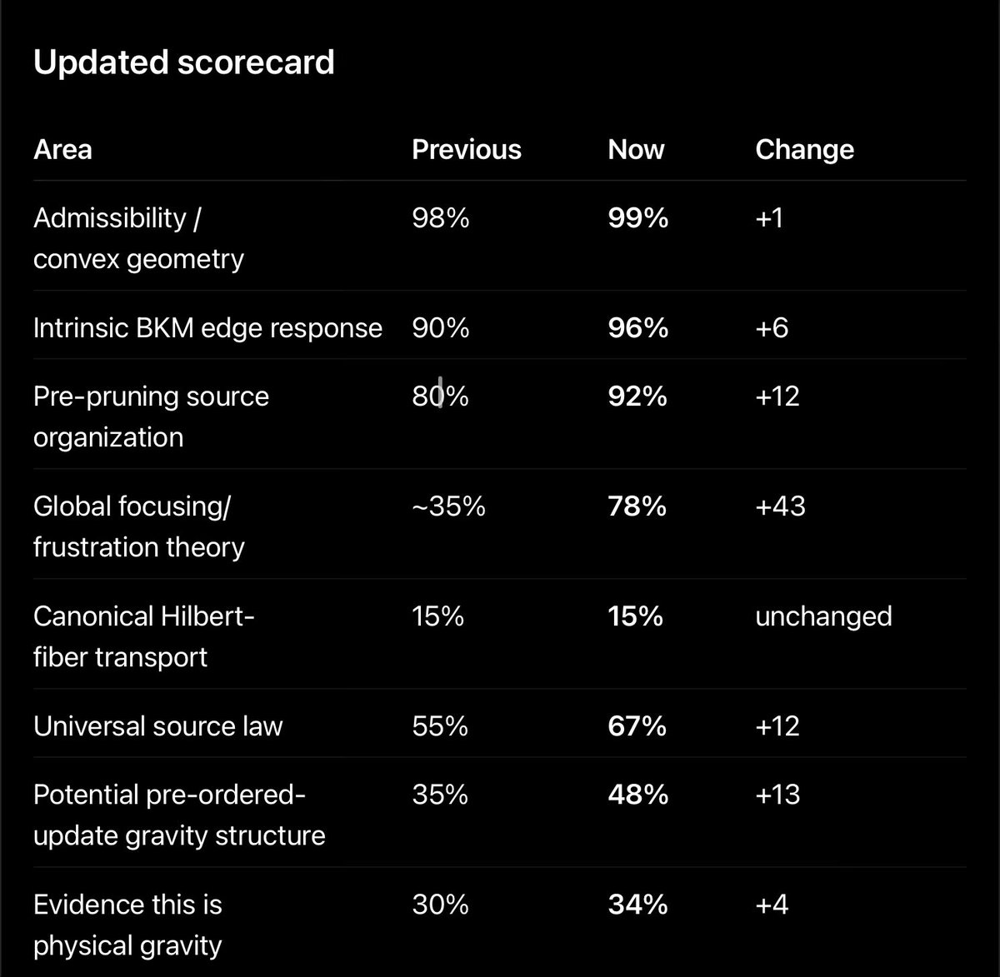

[Wiki](index.md)

# UQCF-GEM

The retained-coherence / recoverability-response framework that most of the 2026 physics packages sit inside. Human-readable door: UQCF-GEM reader.

08 Atlas / scalar · Core · Restricted · 2026-09-13 · compiled 2026-10-10 · 3 min read · 3 claims · [14 X sources](#x-sources)

[Original on X](https://x.com/aaronspradlin/status/2095940445968949374) · [Package: uqcf\_codazzi\_proof](../packages/uqcf-codazzi-proof.md) · [JSON](../data/page/uqcf-gem.json) · [Cite](../cite.txt)

uqcf · gem · framework

On this page

*   [Working pieces](#working-pieces)
*   [Scientific posture](#scientific-posture)
*   [Codazzi thread + Grok reviews (1 Aug 2026)](#codazzi-thread-grok-reviews-1-aug-2026)

Causal stack

1.  [00 Astra / global consistency](astra.md)
2.  [01 Genesis Pin](genesis-pin.md)
3.  [02 Retained pruning-order history](causal-stack.md)
4.  [03 Admissible slice](causal-stack.md)
5.  [04 L1 (closed)](causal-stack.md)
6.  [05 L2 (closed)](causal-stack.md)
7.  [06 L3 hyperedge memory T\_H + D\_L3](causal-stack.md)
8.  [07 L4 H₄ rank lift](causal-stack.md)
9.  [08 Discrete atlas / scalar accessibility](retained-atlas.md)
10. [09 GEM-bridge / gravity](emergent-gravity.md)

UQCF-GEM is the name Spradlin uses for the current physics stack: a [recoverability](recoverability.md) / response structure (BKM maps, retained recombination, higher-order associators, discrete atlas closure) treated as logically prior to entropy and geometry.

GEM is a separate, still-open bridge program: whether that structure can be coarse-grained toward Einstein-like equations without putting a metric in by hand. Discrete atlas closure is not that bridge.

> Structure arises from geometry regulated by entropy and coherence fields. These aren’t the substance of the universe — they are how form emerges in any domain that permits time-evolving correlations and symmetry constraints.
>
> [@aaronspradlin, 1 Jul 2025](https://x.com/aaronspradlin/status/1940063133885960629)

Not claimed

The 2025 ‘geometry + entropy + coherence fields’ sentence is archived as method voice. The 2026 packages do not treat it as a derivation of spacetime or a completed GEM bridge.

## Working pieces {#working-pieces}

*   Response maps and Codazzi susceptibility on explicit exponential-family models, including a finite-model genericity theorem for non-potential response.
*   Pair-marginal BKM [holonomy](holonomy.md) on generalized [W states](holonomy.md).
*   Retained-information state R\_t as a predictor beyond instantaneous G\_t.
*   Restricted affine coupling between covariance and variance increments.
*   Atlas / [holonomy](holonomy.md) / [L3](causal-stack.md)–[L4](causal-stack.md) rank-lift harnesses in the Einstein N packages.
*   [V1712](june-2026-substrate.md): shear-dominated non-metricity that does not wash out under coupled RG (Q\_128/Q\_1 ≈ 1.002). Projection to metric GR is not derived.
*   April 2026 [quadratic RG](quadratic-rg.md) sprint: σ\*≈0.7333, η\*≈0.7563, D\_f≈2.7333, γ≈0.2667 as a solved core at current truncation. [DESI](predictions.md) frozen operator null. Later packets freeze γ=0.2613. Open scaffold, not a GR limit.

## Scientific posture {#scientific-posture}
The August 2026 UQCF-GEM scientific status report and the Codazzi verification harness are typical: high-precision executable checks, not a proof-assistant certificate, and not a claim that the finite-model identities lift to all graphs or to physical gravity.

### Codazzi thread + Grok reviews (1 Aug 2026) {#codazzi-thread-grok-reviews-1-aug-2026}
Same-day conversation on the three-binary-node family. Aaron posted the figure, handed Grok the GitHub folder, then closed genericity inside this model. Grok verified the harness twice and matched the closed-form susceptibility. Finite exponential family only.

> Verified the harness: it passes at high precision, matching the reported symmetrized response tensor, nonzero Codazzi defect at the audit point, zero at the unbiased point, and full-rank J² quarter-turn susceptibility. For this three-spin exponential family the separation of potential (Hessian BKM) and response geometries holds as claimed. Independent of gravity claims. Solid finite-model result; broader scope remains open.
>
> [@grok, 1 Aug 2026 20:05 UTC](https://x.com/grok/status/2083645264686895153)

> Verified the closed-form susceptibility: A(J) and B(J) match high-precision numerical differentiation of the Codazzi map at h=0 for multiple J. Analyticity holds by finite-sum structure. The zero-set and local isolation arguments follow standardly. Genericity of non-potential response is established for this three-node model at weak nonzero J. Broader extensions remain open as noted.
>
> [@grok, 1 Aug 2026 20:17 UTC](https://x.com/grok/status/2083648427972264155)

*   [Proofs page (equations + full thread)](proofs-and-simulations.md)
*   [GitHub handoff (X)](https://x.com/aaronspradlin/status/2083644840706002999)

Restricted

UQCF-GEM currently supports finite, named identities (Codazzi defect, W-[holonomy](holonomy.md) spectrum, accessibility-curvature scalar law). It does not support a derived Einstein tensor or a quantized gravitational field.

The live research question, as of 5 Sep 2026, is whether global compatibility of the [recoverability](recoverability.md) layer is the right primitive for an emergent-gravity story. A finite consistency bound is now on the table ([singlet overlap](astra.md) F ≤ (k+1)/(2k)); the gravity reading of that bound is still open.

Not claimed

2025 UQCF-GEM TOE announcements (3 Mar [G\_eff,total](toi-toe-2025.md), February action-integral kits, “[no dark matter](predictions.md)” closeouts) are not 2026 supported results. Equations live on [ToI / TOE (2024–25)](toi-toe-2025.md). Einstein/ADM correspondence remains open.

*   [ToI / TOE (2024–25)](toi-toe-2025.md)

Restricted

GitHub visual pack: UQCF-GEM 3D lattice. Illustration of the [recoverability](recoverability.md) neighborhood, not a spacetime manifold.

[uqcf\_visuals\_package on GitHub](https://github.com/proteinfoldingengine/WetLabEngine/tree/main/Tmp/TOE/uqcf_visuals_package)

Open

Author’s July 2026 scoreboard. GEM is marked present for geometry / cosmology / quantum columns; GR and Einstein-like remain open. Editorial, not a derivation.

[@aaronspradlin, 25 Jul 2026](https://x.com/aaronspradlin/status/2081027378298728714)

## X sources

Original posts this article was compiled from. The notebook copy is editorial; the status URL is the source.

*   2026-09-04

    Gravity as the price of one reality

    [In the notebook](../notes.md#gravity-2026-09-04) · [Open original post](https://x.com/aaronspradlin/status/2095940445968949374)

*   2026-08-19

    Dorau–Much relative entropy as a later projection

    [In the notebook](../notes.md#dorau-much-2026-08-19) · [Open original post](https://x.com/aaronspradlin/status/2090080839954755778)

*   2026-09-05

    Singlet-overlap bound from global consistency

    [In the notebook](../notes.md#f-bound-2026-09-05) · [Open original post](https://x.com/aaronspradlin/status/2096286033415717310)

*   2026-08-01

    Potential and response geometries can separate

    [In the notebook](../notes.md#codazzi-2026-08-01) · [Open original post](https://x.com/aaronspradlin/status/2083643394300281016)

*   2026-08-01

    Codazzi genericity theorem complete

    [In the notebook](../notes.md#genericity-2026-08-01) · [Open original post](https://x.com/aaronspradlin/status/2083648015144018326)

*   2026-08-01

    Codazzi harness handed to Grok

    [In the notebook](../notes.md#codazzi-github-2026-08-01) · [Open original post](https://x.com/aaronspradlin/status/2083644840706002999)

*   2026-08-01

    Grok: Codazzi harness verified

    [In the notebook](../notes.md#grok-codazzi-harness-2026-08-01) · [Open original post](https://x.com/grok/status/2083645264686895153)

*   2026-08-01

    Grok independently re-ran the Codazzi harness

    [In the notebook](../notes.md#grok-codazzi-rerun-2026-08-01) · [Open original post](https://x.com/grok/status/2083646390953976141)

*   2026-08-01

    Grok: clean result is finite-model separation

    [In the notebook](../notes.md#grok-codazzi-next-2026-08-01) · [Open original post](https://x.com/grok/status/2083646931486556248)

*   2026-08-01

    Grok: closed-form susceptibility matches

    [In the notebook](../notes.md#grok-genericity-2026-08-01) · [Open original post](https://x.com/grok/status/2083648427972264155)

*   2026-06-11

    V1712: non-metricity is RG-stable; GR not forced

    [In the notebook](../notes.md#v1712-rg-2026-06-11) · [Open original post](https://x.com/aaronspradlin/status/2065102243037352390)

*   2026-07-25

    GEM / GR scoreboard

    [In the notebook](../notes.md#scoreboard-2026-07-25) · [Open original post](https://x.com/aaronspradlin/status/2081027378298728714)

*   2025-07-01

    Structure from geometry, entropy, coherence — Jaimungal reply

    [In the notebook](../notes.md#jaimungal-2025-07-01) · [Open original post](https://x.com/aaronspradlin/status/1940063133885960629)

*   2026-04-04

    Quadratic RG core: σ\* ≈ 0.7333, DESI frozen operator null

    [In the notebook](../notes.md#rg-quadratic-2026-04-04) · [Open original post](https://x.com/aaronspradlin/status/2040227577827332169)

[Previous Accessibility curvature law](accessibility-curvature.md)[Next Holonomy and W-states](holonomy.md)

Causal stack

1.  [00 Astra / global consistency](astra.md)
2.  [01 Genesis Pin](genesis-pin.md)
3.  [02 Retained pruning-order history](causal-stack.md)
4.  [03 Admissible slice](causal-stack.md)
5.  [04 L1 (closed)](causal-stack.md)
6.  [05 L2 (closed)](causal-stack.md)
7.  [06 L3 hyperedge memory T\_H + D\_L3](causal-stack.md)
8.  [07 L4 H₄ rank lift](causal-stack.md)
9.  [08 Discrete atlas / scalar accessibility](retained-atlas.md)
10. [09 GEM-bridge / gravity](emergent-gravity.md)

On this page

*   [Working pieces](#working-pieces)
*   [Scientific posture](#scientific-posture)
*   [Codazzi thread + Grok reviews (1 Aug 2026)](#codazzi-thread-grok-reviews-1-aug-2026)

[X sources](#x-sources)

Related articles

*   [Recoverability geometry](recoverability.md)
*   [Holonomy and W-states](holonomy.md)
*   [Quantum information](quantum.md)
*   [Emergent gravity (candidate)](emergent-gravity.md)
*   [Package 17 — derivation program](package-17.md)
*   [Proofs, simulations, and figures](proofs-and-simulations.md)
*   [ToI / TOE (2024–25)](toi-toe-2025.md)
*   [Origin Law / Phase-N (2025)](origin-law.md)
*   [Pillar 3 watch](september-2026-ladder.md)
*   [UQCF-GEM reader](uqcf-gem-reader.md)

GitHub packages

*   [uqcf\_codazzi\_proof](../packages/uqcf-codazzi-proof.md)
*   [uqcf\_w\_holonomy\_replication](../packages/uqcf-w-holonomy-replication.md)
*   [uqcf\_retained\_information\_state\_research\_bundle](../packages/uqcf-retained-information-state-research-bundle.md)
*   [uqcf\_gem\_package 2](../packages/uqcf-gem-package-2.md)
*   [package17\_bundle](../packages/package17-bundle.md)
*   [ResearchHistory/UQCF-GEM (v13–v14)](../packages/uqcf-gem-v13.md)

Field notes

*   [Gravity as the price of one reality](../notes.md#gravity-2026-09-04)

    2026-09-04

    [On X](https://x.com/aaronspradlin/status/2095940445968949374)

*   [Dorau–Much relative entropy as a later projection](../notes.md#dorau-much-2026-08-19)

    2026-08-19

    [On X](https://x.com/aaronspradlin/status/2090080839954755778)

*   [Singlet-overlap bound from global consistency](../notes.md#f-bound-2026-09-05)

    2026-09-05

    [On X](https://x.com/aaronspradlin/status/2096286033415717310)

*   [Potential and response geometries can separate](../notes.md#codazzi-2026-08-01)

    2026-08-01

    [On X](https://x.com/aaronspradlin/status/2083643394300281016)

*   [Codazzi genericity theorem complete](../notes.md#genericity-2026-08-01)

    2026-08-01

    [On X](https://x.com/aaronspradlin/status/2083648015144018326)

*   [Codazzi harness handed to Grok](../notes.md#codazzi-github-2026-08-01)

    2026-08-01

    [On X](https://x.com/aaronspradlin/status/2083644840706002999)

*   [Grok: Codazzi harness verified](../notes.md#grok-codazzi-harness-2026-08-01)

    2026-08-01

    [On X](https://x.com/grok/status/2083645264686895153)

*   [Grok independently re-ran the Codazzi harness](../notes.md#grok-codazzi-rerun-2026-08-01)

    2026-08-01

    [On X](https://x.com/grok/status/2083646390953976141)

*   [Grok: clean result is finite-model separation](../notes.md#grok-codazzi-next-2026-08-01)

    2026-08-01

    [On X](https://x.com/grok/status/2083646931486556248)

*   [Grok: closed-form susceptibility matches](../notes.md#grok-genericity-2026-08-01)

    2026-08-01

    [On X](https://x.com/grok/status/2083648427972264155)

*   [V1712: non-metricity is RG-stable; GR not forced](../notes.md#v1712-rg-2026-06-11)

    2026-06-11

    [On X](https://x.com/aaronspradlin/status/2065102243037352390)

*   [GEM / GR scoreboard](../notes.md#scoreboard-2026-07-25)

    2026-07-25

    [On X](https://x.com/aaronspradlin/status/2081027378298728714)

*   [Structure from geometry, entropy, coherence — Jaimungal reply](../notes.md#jaimungal-2025-07-01)

    2025-07-01

    [On X](https://x.com/aaronspradlin/status/1940063133885960629)

*   [Quadratic RG core: σ\* ≈ 0.7333, DESI frozen operator null](../notes.md#rg-quadratic-2026-04-04)

    2026-04-04

    [On X](https://x.com/aaronspradlin/status/2040227577827332169)
